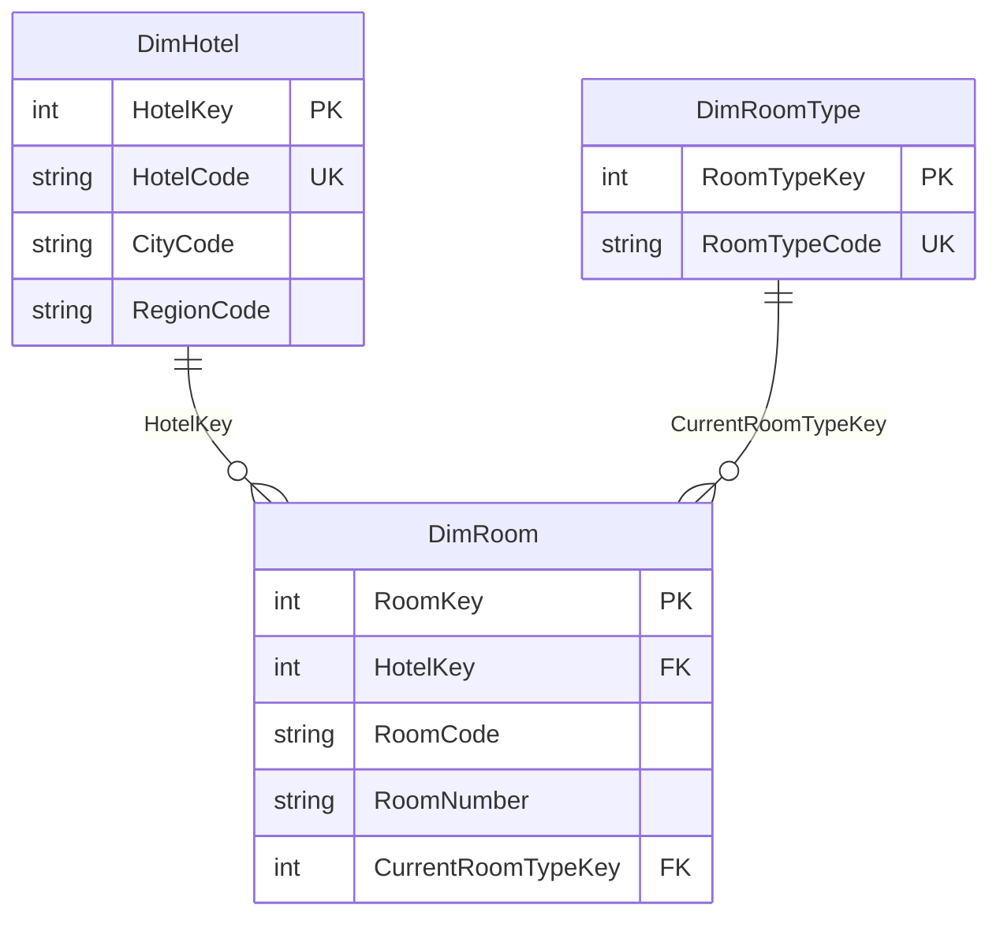
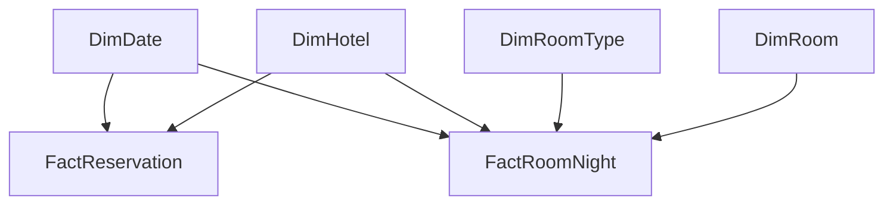
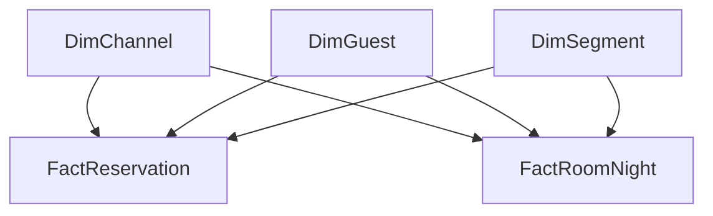

# US-03-03 | Zaprojektowanie wspólnych wymiarów analitycznych

Data opracowania: 02.11.2026. Epika: EPIC-03: Hurtownia i modelowanie danych. MoSCoW: Must. Sprint: 1.

**Status: projekt logiczny i kompletna propozycja słowników v1 przygotowane do uzgodnienia.** Aktualizacja 02.11.2026 — korekta po otrzymaniu pełnych treści US-02-06, US-03-04 i US-03-05. Kontrakt danych syntetycznych przygotowano w ramach US-03-03; nie wymaga oczekiwania na wygenerowane dane. Nie potwierdzono przyjęcia kontraktu ani odbioru przez zespół/PO.

## 1. Cel i zakres

Jako analityk danych chcę korzystać ze wspólnych wymiarów daty, hotelu, pokoju, kanału sprzedaży i gościa, aby porównywać wskaźniki między hotelami i okresami bez niespójnych definicji.

Rezultat obejmuje sześć wymiarów wskazanych w historii oraz uzupełniający DimSegment dla filtra z R-06, ich atrybuty, BK/SK, reguły integralności, schemat relacji i kontrakty planowanych faktów. Zasilanie, fizyczne DDL, wdrożenie modelu BI i SCD2 nie należą do tej realizacji Sprintu 1. US-03-06 pozostaje właścicielem historii gościa.

W starszej macierzy S-03 przy US-03-03 wpisano DDL. Przyjęto nowszy zakres przesłany przez użytkownika (S-01): projekt logiczny. Nie zmieniono samodzielnie katalogu wymagań ani statusu karty w Trello.

## 2. Zestaw wymiarów

| Wymiar | Ziarno | SK | BK | Oczekiwane źródło | Cel | Zakres |
| --- | --- | --- | --- | --- | --- | --- |
| DimDate | Jeden dzień kalendarzowy | DateKey | FullDate | Kalendarz generowany, niezależny od źródeł | Daty pobytu, rezerwacji i okresów sprawozdawczych | Podstawowy |
| DimHotel | Jeden hotel sieci | HotelKey | HotelCode | Rejestr hoteli + mapowania identyfikatorów PMS/POS/finansów | Hotel → miasto → region; tożsamość niezależna od nazwy | Podstawowy |
| DimRoomType | Jeden wspólny typ pokoju w zatwierdzonej klasyfikacji sieci | RoomTypeKey | RoomTypeCode | Wspólny słownik + lokalne kody typów w PMS | Porównywalny typ pokoju; np. STANDARD lub SUITE | Podstawowy |
| DimRoom | Jeden fizyczny pokój w hotelu | RoomKey | HotelCode + RoomCode | Ewidencja fizycznych pokoi PMS | Fizyczny pokój odrębny od typu; numer nie jest globalnym ID | Podstawowy |
| DimChannel | Jeden kanał sprzedaży w klasyfikacji sieci | ChannelKey | ChannelCode | PMS / Channel Manager + wspólny słownik | Kanał i grupa kanału, np. BOOKING_COM / OTA | Podstawowy |
| DimGuest | Jeden zidentyfikowany profil gościa; model bazowy bez SCD2 | GuestKey | GuestBusinessId | PMS / CRM; mapowanie profili do bezpiecznego identyfikatora | Gość główny rezerwacji; historia i scalanie profili osobno | Podstawowy |
| DimSegment | Jeden segment rynkowy rezerwacji | SegmentKey | SegmentCode | PMS / CRM + wspólny słownik segmentów | Filtr segmentu z R-06; segment przypisany do transakcji | Uzupełnienie R-06 |

## 3. Nazewnictwo i klucze

- Nazwy tabel: `Dim` + nazwa w liczbie pojedynczej, np. `DimHotel`. Nazwy atrybutów: PascalCase, bez spacji i polskich znaków.
- PK wymiaru jest technicznym kluczem zastępczym `...Key`, niezależnym od ID konkretnego systemu. Wszystkie fakty używają tych samych wspólnych wymiarów.
- BK identyfikuje obiekt biznesowy. `HotelCode`, `RoomTypeCode`, `ChannelCode` i `SegmentCode` należą do uzgodnionych rejestrów sieci. Nie są automatycznie nazwą obiektu ani surowym kodem jednego PMS.
- `DimRoom`: unikalność `(HotelKey, RoomCode)` odpowiada biznesowemu `(HotelCode, RoomCode)`. Numer 101 może wystąpić w wielu hotelach. Zmiana numeru nie tworzy nowego fizycznego pokoju.
- `DimDate`: BK = `FullDate`, SK = niezależny `DateKey` typu INTEGER. Nie zakłada się wartości YYYYMMDD ani operacji arytmetycznych na DateKey.
- `DimGuest`: BK = `GuestBusinessId`, SK = `GuestKey`. W tym projekcie bazowym profil ma jeden rekord. W US-03-06 BK będzie mógł wskazywać wiele wersji; nie utrwalać globalnego UNIQUE na GuestBusinessId w docelowej tabeli SCD2.
- Typy INTEGER, TEXT, DATE i BOOLEAN są logiczne. Długości kolumn, sposób generowania kluczy, indeksy i dialekt SQL ustala się po wyborze platformy i profilowaniu źródeł.

### Rekordy specjalne

Przyjęta konwencja do zatwierdzenia: `0` = nieznane / brak mapowania, `-1` = nie dotyczy; dodatkowo `DimRoom.RoomKey = -2` = pokój jeszcze nieprzydzielony. FK są niepuste i wskazują istniejący rekord specjalny. Znane, lecz niepoprawne odwołanie trafia do rejestru problemów danych, a nie do przypadkowo utworzonego obiektu. Nie utożsamiać nieznanego hotelu z brakiem zastosowania hotelu.

Wymiary mają osobne etykiety rekordów specjalnych i zarezerwowane kody techniczne. `FullDate` i atrybuty kalendarzowe tych rekordów mogą być NULL; nie stosować fikcyjnego 1900-01-01 jako zwykłej daty. `Tak*` w słowniku oznacza obowiązek dla zwykłego rekordu. Specjalny DimRoom odwołuje się do odpowiednich specjalnych hotelu i typu; reguła zgodności hotelu faktu z hotelem pokoju dotyczy tylko RoomKey > 0.

## 4. Atrybuty wymiarów

### DimDate

| Atrybut | Typ logiczny | Klucz | Wymagany | Znaczenie | Reguła |
| --- | --- | --- | --- | --- | --- |
| DateKey | INTEGER | PK / SK | Tak | Techniczny klucz daty | Nadawany centralnie; nie zawiera daty źródłowej; 0 = nieznana, -1 = nie dotyczy. |
| FullDate | DATE | BK / UNIQUE | Tak* | Data kalendarzowa | Unikalna dla zwykłych rekordów; NULL tylko w rekordach specjalnych. |
| CalendarYear | INTEGER | Atrybut | Tak* | Rok kalendarzowy | Wyznaczony z FullDate. |
| QuarterNumber | INTEGER | Atrybut | Tak* | Kwartał | 1–4. |
| MonthNumber | INTEGER | Atrybut | Tak* | Miesiąc | 1–12; sortowanie MonthName. |
| MonthName | TEXT | Atrybut | Tak* | Polska nazwa miesiąca | Jednolity słownik językowy. |
| DayOfMonth | INTEGER | Atrybut | Tak* | Dzień miesiąca | 1–31 zgodnie z datą. |
| DayOfWeekNumber | INTEGER | Atrybut | Tak* | Numer dnia tygodnia | Poniedziałek = 1, niedziela = 7. |
| DayOfWeekName | TEXT | Atrybut | Tak* | Polska nazwa dnia tygodnia | Sortowanie DayOfWeekNumber. |
| ISOWeekNumber | INTEGER | Atrybut | Tak* | Tydzień ISO | 1–53; używać razem z ISOWeekYear. |
| ISOWeekYear | INTEGER | Atrybut | Tak* | Rok tygodnia ISO | Może różnić się od CalendarYear na przełomie lat. |
| MonthStartDate | DATE | Atrybut | Tak* | Pierwszy dzień miesiąca | Pozwala wskazać okres faktu miesięcznego. |
| IsWeekend | BOOLEAN | Atrybut | Tak* | Czy sobota lub niedziela | Wynika z DayOfWeekNumber. |

### DimHotel

| Atrybut | Typ logiczny | Klucz | Wymagany | Znaczenie | Reguła |
| --- | --- | --- | --- | --- | --- |
| HotelKey | INTEGER | PK / SK | Tak | Techniczny klucz hotelu | Stały przy zmianie nazwy hotelu. |
| HotelCode | TEXT | BK / UNIQUE | Tak* | Stały kod hotelu w sieci | Nie kod nazwy miasta; różne źródłowe ID mapują się na ten sam HotelCode. |
| HotelName | TEXT | Atrybut | Tak* | Nazwa hotelu | Nazwa nie jest kluczem. |
| CityCode | TEXT | Atrybut | Tak* | Kod miasta w rejestrze sieci | Identyfikuje miasto w kraju, niezależnie od pisowni nazwy. |
| CityName | TEXT | Atrybut | Tak* | Nazwa miasta | CityCode jednoznacznie określa CityName i RegionCode. |
| RegionCode | TEXT | Atrybut | Tak* | Kod regionu w rejestrze sieci | Propozycja: jednostka administracyjna; definicja do zatwierdzenia. |
| RegionName | TEXT | Atrybut | Tak* | Nazwa regionu | RegionCode jednoznacznie określa nazwę i kraj. |
| CountryCode | TEXT | Atrybut | Tak* | Kod kraju hotelu | Jeden ustalony słownik kodów krajów. |
| TimeZoneId | TEXT | Atrybut | Tak* | Strefa czasowa hotelu | Używana przy wyznaczaniu lokalnej daty biznesowej; identyfikator zgodny z wybraną platformą. |
| HotelCategory | TEXT | Atrybut | Nie | Kategoria biznesowa hotelu | Np. CITY, RESORT, APARTHOTEL; słownik do uzgodnienia. |
| IsActive | BOOLEAN | Atrybut | Tak* | Czy hotel jest aktywny | Zamknięcie nie usuwa historii ani nie zwalnia HotelCode do ponownego użycia. |

### DimRoomType

| Atrybut | Typ logiczny | Klucz | Wymagany | Znaczenie | Reguła |
| --- | --- | --- | --- | --- | --- |
| RoomTypeKey | INTEGER | PK / SK | Tak | Techniczny klucz typu pokoju | Wspólny dla całej sieci. |
| RoomTypeCode | TEXT | BK / UNIQUE | Tak* | Kod wspólnego typu | Katalog v1 w Slowniki: STANDARD, SUPERIOR, SUITE, APARTMENT, OTHER oraz kody techniczne; do uzgodnienia. |
| RoomTypeName | TEXT | Atrybut | Tak* | Nazwa wspólnego typu | Jednakowe znaczenie we wszystkich hotelach. |
| RoomTypeDescription | TEXT | Atrybut | Tak* | Kryteria zaliczenia do typu | Opis zatwierdzony przez biznes; nie samo dopasowanie podobnych nazw. |
| IsActive | BOOLEAN | Atrybut | Tak* | Czy typ jest używany | Wycofany typ pozostaje dla historycznych faktów. |

### DimRoom

| Atrybut | Typ logiczny | Klucz | Wymagany | Znaczenie | Reguła |
| --- | --- | --- | --- | --- | --- |
| RoomKey | INTEGER | PK / SK | Tak | Techniczny klucz fizycznego pokoju | Nigdy nie wyliczać wyłącznie z numeru pokoju. |
| HotelKey | INTEGER | FK → DimHotel.HotelKey | Tak | Hotel będący właścicielem pokoju | Każdy zwykły pokój ma dokładnie jeden hotel. |
| RoomCode | TEXT | Składnik BK | Tak* | Stały identyfikator pokoju w hotelu | UNIQUE (HotelKey, RoomCode); RoomCode pozostaje stały po zmianie numeru wyświetlanego. |
| RoomNumber | TEXT | Atrybut | Tak* | Numer lub oznaczenie pokoju | Np. 101, 01A; tekst zachowuje zera i litery. Nie musi być unikalny między hotelami. |
| CurrentRoomTypeKey | INTEGER | FK → DimRoomType.RoomTypeKey | Tak | Bieżący typ fizycznego pokoju | Tylko opis bieżący; typ historyczny pobierany z faktu dla danej daty. |
| FloorLabel | TEXT | Atrybut | Nie | Oznaczenie piętra | Tekst, np. 0, 1, antresola; potwierdzić dostępność. |
| CapacityAdults | INTEGER | Atrybut | Nie | Bieżąca pojemność dorosłych | Nieujemna liczba; brak nie oznacza zera. |
| CapacityChildren | INTEGER | Atrybut | Nie | Bieżąca pojemność dzieci | Nieujemna liczba; definicja wieku do uzgodnienia. |
| IsActive | BOOLEAN | Atrybut | Tak* | Czy pokój należy do aktywnego zasobu | Nie jest statusem OOO dla konkretnego dnia. |

### DimChannel

| Atrybut | Typ logiczny | Klucz | Wymagany | Znaczenie | Reguła |
| --- | --- | --- | --- | --- | --- |
| ChannelKey | INTEGER | PK / SK | Tak | Techniczny klucz kanału | Wspólny dla źródeł i hoteli. |
| ChannelCode | TEXT | BK / UNIQUE | Tak* | Kod kanału sieci | Np. BOOKING_COM, DIRECT_WEB, DIRECT_PHONE. |
| ChannelName | TEXT | Atrybut | Tak* | Nazwa kanału | Jedna nazwa biznesowa po normalizacji kodów. |
| ChannelGroupCode | TEXT | Atrybut | Tak* | Grupa dystrybucji | Katalog v1: DIRECT, OTA, AGENCY, GDS, OTHER; grupa wyznaczana przez ChannelCode; techniczne UNKNOWN/NOT_APPLICABLE. |
| IsActive | BOOLEAN | Atrybut | Tak* | Czy kanał jest wykorzystywany | Prowizja transakcji nie jest stałą cechą kanału. |

### DimGuest

| Atrybut | Typ logiczny | Klucz | Wymagany | Znaczenie | Reguła |
| --- | --- | --- | --- | --- | --- |
| GuestKey | INTEGER | PK / SK | Tak | Techniczny klucz rekordu gościa | Docelowo klucz wersji po wdrożeniu SCD2 w US-03-06. |
| GuestBusinessId | TEXT | BK | Tak* | Trwały pseudonim profilu biznesowego | W bazie logicznej bez historii jeden rekord na ID; docelowo jedno ID może mieć wiele wersji SCD2. |
| GuestCountryCode | TEXT | Atrybut | Nie | Kraj zamieszkania gościa | Proponowana jedna definicja: kraj zamieszkania, nie obywatelstwo; do uzgodnienia. |
| LoyaltyLevelCode | TEXT | Atrybut | Nie | Poziom programu lojalnościowego | Kandydat do historyzacji w US-03-06; brak profilu nie oznacza braku członkostwa. |
| IsActive | BOOLEAN | Atrybut | Tak* | Czy profil pozostaje aktywny | Nie zastępuje obsługi usunięcia danych ani reguł retencji. |

### DimSegment

| Atrybut | Typ logiczny | Klucz | Wymagany | Znaczenie | Reguła |
| --- | --- | --- | --- | --- | --- |
| SegmentKey | INTEGER | PK / SK | Tak | Techniczny klucz segmentu | Przechowywany w fakcie rezerwacji / pokojonocy. |
| SegmentCode | TEXT | BK / UNIQUE | Tak* | Kod segmentu rynkowego | Katalog v1: GROUP, BUSINESS, LEISURE, OTHER; reguła pierwszeństwa grupy; techniczne UNKNOWN/NOT_APPLICABLE. |
| SegmentName | TEXT | Atrybut | Tak* | Nazwa segmentu | Spójna dla sieci. |
| SegmentDescription | TEXT | Atrybut | Tak* | Reguła klasyfikacji rezerwacji | Nie wyprowadzać segmentu wyłącznie z kanału lub aktualnej cechy gościa. |
| IsActive | BOOLEAN | Atrybut | Tak* | Czy segment jest używany | Wycofanie nie usuwa historycznych przypisań. |

## 5. Mapowanie źródeł i wspólne definicje

Przygotowano kontrakt danych syntetycznych w sekcji 14; rzeczywiste nazwy kolumn źródeł nie zostały potwierdzone. Poniższe pola kontraktu są nazwami projektowymi, a nie deklaracją znalezionych pól PMS. Źródło każdego atrybutu opisuje kolumna „Oczekiwane źródło” w zestawie wymiarów; szczegółowy source-to-target powstanie po U-01.

| Obiekt mapowania | Klucz źródłowy (propozycja) | Cel | Reguła |
| --- | --- | --- | --- |
| Hotel | SourceSystemCode + SourceHotelId | HotelCode → HotelKey | SourceSystemCode identyfikuje instancję/tenant, nie tylko producenta PMS. |
| Pokój | SourceSystemCode + SourceHotelId + SourceRoomId | HotelCode + RoomCode → RoomKey | Nie scalać pokoi po samym numerze. |
| Typ pokoju | SourceSystemCode + SourceHotelId + SourceRoomTypeCode | RoomTypeCode → RoomTypeKey | Wiele lokalnych kodów może wskazywać jeden wspólny typ. |
| Kanał | SourceSystemCode + SourceHotelId + SourceChannelCode | ChannelCode → ChannelKey | Jeśli słownik źródłowy jest globalny, zakres hotelu zastępuje jawny kod wspólnego słownika. |
| Segment | SourceSystemCode + SourceHotelId + SourceSegmentCode | SegmentCode → SegmentKey | Uzgodniona klasyfikacja rezerwacji, niezależna od kanału. |
| Gość | SourceSystemCode + SourceHotelId + SourceGuestId | GuestBusinessId → GuestKey / przyszła wersja | Zakres hotelu może być wspólny tylko przy potwierdzonej globalnej unikalności profilu. |
| Data | Timestamp / data biznesowa z odpowiednią rolą | FullDate → DateKey | Uwzględnić strefę i granicę doby; nie zmieniać już poprawnej daty biznesowej PMS. |

Mapowania są konfiguracją warstwy integracji, nie dodatkowymi wymiarami wliczanymi do minimum. Dla zmian klasyfikacji potrzebne są daty obowiązywania `[ValidFrom, ValidTo)`; dla danego klucza i daty obowiązuje maksymalnie jedno mapowanie. Zmiana klasyfikacji nie może bez decyzji biznesowej przeliczyć historycznych faktów. Implementacja i zasilanie mapowań są zadaniem ETL.

Gości nie scala się automatycznie po imieniu, nazwisku lub podobnym e-mailu. Do czasu potwierdzenia wspólnego ID profil jest rozróżniany w zakresie źródła. DimGuest nie przechowuje imion, nazwisk, adresów e-mail, telefonów ani numerów dokumentów. GuestBusinessId to nieodwracalny z perspektywy raportu token z kontrolowanym mapowaniem poza warstwą raportową. Nie jest to potwierdzenie pełnej realizacji NFR-03.

## 6. Hierarchia hotelu i rozróżnienie pokoju

Hierarchia znajduje się w DimHotel: `HotelCode → CityCode → RegionCode → CountryCode`. W raporcie rozwija się ją w odwrotnej kolejności: region → miasto → hotel. Nie są potrzebne osobne DimCity i DimRegion dla tej historii. Muszą zachodzić zależności: HotelCode wyznacza jeden hotel i miasto; CityCode wyznacza jeden region; RegionCode wyznacza kraj. Jeżeli biznes definiuje region jako obszar handlowy mogący przecinać miasta, konieczna jest zmiana tej hierarchii przed odbiorem.

**Przykład syntetyczny, nie dane źródłowe:**

| HotelKey | HotelCode | CityCode | RegionCode |
| --- | --- | --- | --- |
| 101 | H-KRK-01 | PL-KRK | PL-MAL |
| 102 | H-KRK-02 | PL-KRK | PL-MAL |
| 103 | H-WAW-01 | PL-WAW | PL-MAZ |

| RoomKey | HotelKey | RoomCode | RoomNumber | CurrentRoomTypeKey |
| --- | --- | --- | --- | --- |
| 1001 | 101 | R-A | 101 | 10 |
| 1002 | 101 | R-B | 102 | 10 |
| 1003 | 102 | R-A | 101 | 10 |

Typ `RoomTypeKey = 10` oznacza w przykładzie STANDARD, `20` oznacza SUITE. Pokoje 1001 i 1002 mają wspólny typ. Pokoje 1001 i 1003 mają ten sam numer, lecz są odrębnymi obiektami.

`CurrentRoomTypeKey` opisuje stan bieżący. Fakty przechowują własny typ dla daty zdarzenia: w pokojonocy BookedRoomTypeKey oraz OccupiedRoomTypeKey (typ zamówiony pochodzi ze szczegółów pokojowych rezerwacji), a w dostępności RoomTypeKey. Upgrade nie zmienia zamówionego typu. Historycznego typu nie odtwarza się przez bieżący atrybut DimRoom. OOO jest stanem pokoju dla konkretnej daty w FactRoomInventory, a nie stałą cechą DimRoom.

## 7. Planowane fakty i relacje

Ziarna trzech głównych faktów wynikają z przesłanych US-03-04/05. Nazwy FK i rozszerzenia gościa/segmentu są propozycją projektową. Fakty finansowe i POS pozostają wstępną propozycją poza bieżącym uzgodnieniem. Implementacja faktów nie jest częścią US-03-03.

| Fakt | Właściciel zakresu | Proponowane ziarno | Klucz ziarna | Uwagi |
| --- | --- | --- | --- | --- |
| FactReservation | US-03-04 — Sprint 2 | Jeden rekord na identyfikator rezerwacji — aktualny stan | SourceSystemCode + SourceHotelId + ReservationId (proponowany zakres ID) | Ziarno zgodne z treścią US-03-04. Rezerwacja wielopokojowa nie mnoży wierszy. Daty, hotel, kanał, status, data anulacji, kwoty i uzgodniona waluta. Dekompozycja pokojowa w US-03-05. |
| FactRoomNight | US-03-05 — Sprint 2 | Pojedynczy fizyczny pokój × noc pobytu | RoomKey + StayDateKey | Ziarno zgodne z US-03-05; identyfikator rezerwacji/pobytu jest odwołaniem, nie dodatkowym ziarnem. Konflikt wielu pobytów tego samego pokoju/nocy wymaga reguły rozstrzygnięcia. Plan bez przydzielonego pokoju opisany osobno. |
| FactRoomInventory | US-03-05 — Sprint 2 | Jeden fizyczny pokój × jedna lokalna data biznesowa | RoomKey + InventoryDateKey | Jeden wiersz także dla pokoju niesprzedanego/OOO. Stan dostępności jest zachowany. Reguły OCC i doby hotelowej uzgadniane z PO w US-03-05; nie są implementowane w US-03-03. |
| FactFinanceMonthly | US-03-08 | Hotel × miesiąc × kategoria finansowa × scenariusz | Kontrakt do zatwierdzenia przez US-03-08 | MonthDateKey wskazuje pierwszy dzień miesiąca. Kategoria i scenariusz poza US-03-03. Kwot miesięcznych nie rozdziela się automatycznie na dni. |
| FactAncillaryRevenue | US-03-11 | Jedna pozycja transakcji POS / usługi | Źródło + identyfikator transakcji + identyfikator pozycji | Data sprzedaży i hotel zawsze określone; powiązanie do pokoju/gościa tylko jeśli istnieje w źródle. Kategorie usług poza tą historią. |

### Macierz relacji

| Tabela podrzędna | Kolumna FK | Wymiar nadrzędny | Kolumna PK | Krotność | Znaczenie / rola | Reguła |
| --- | --- | --- | --- | --- | --- | --- |
| DimRoom | HotelKey | DimHotel | HotelKey | N:1 | Własność fizycznego pokoju | Zgodność HotelKey faktu z hotelem pokoju; relacja strukturalna, nie druga aktywna ścieżka filtrowania w BI. |
| DimRoom | CurrentRoomTypeKey | DimRoomType | RoomTypeKey | N:1 | Bieżący typ pokoju | Nie stosować do odtwarzania typu historycznego faktu. |
| FactReservation | BookingDateKey | DimDate | DateKey | N:1 | Data utworzenia | Dokładnie jeden rekord wymiaru na FK, w tym rekord specjalny. |
| FactReservation | ArrivalDateKey | DimDate | DateKey | N:1 | Planowany przyjazd | Dokładnie jeden rekord wymiaru na FK, w tym rekord specjalny. |
| FactReservation | DepartureDateKey | DimDate | DateKey | N:1 | Planowany wyjazd | Dokładnie jeden rekord wymiaru na FK, w tym rekord specjalny. |
| FactReservation | CancellationDateKey | DimDate | DateKey | N:1 | Data anulowania; -1 dla nieanulowanej | Dokładnie jeden rekord wymiaru na FK, w tym rekord specjalny. |
| FactReservation | HotelKey | DimHotel | HotelKey | N:1 | Hotel rezerwacji | Dokładnie jeden rekord wymiaru na FK, w tym rekord specjalny. |
| FactReservation | ChannelKey | DimChannel | ChannelKey | N:1 | Kanał rezerwacji | Dokładnie jeden rekord wymiaru na FK, w tym rekord specjalny. |
| FactReservation | PrimaryGuestKey | DimGuest | GuestKey | N:1 | Gość główny; nie lista wszystkich gości | Rozszerzenie proponowane w US-03-03, niewymagane wprost przez US-03-04; jedna wartość na nagłówek, do przeglądu. |
| FactReservation | SegmentKey | DimSegment | SegmentKey | N:1 | Segment tej rezerwacji | Rozszerzenie proponowane w US-03-03, niewymagane wprost przez US-03-04; jedna wartość na nagłówek, do przeglądu. |
| FactRoomNight | StayDateKey | DimDate | DateKey | N:1 | Noc pobytu; dzień wyjazdu wyłączony | Dokładnie jeden rekord wymiaru na FK, w tym rekord specjalny. |
| FactRoomNight | HotelKey | DimHotel | HotelKey | N:1 | Hotel pobytu | Dokładnie jeden rekord wymiaru na FK, w tym rekord specjalny. |
| FactRoomNight | RoomKey | DimRoom | RoomKey | N:1 | Fizyczny pokój przypisany do nocy | RoomKey > 0 dla faktu o ziarnie pokój × noc. Nie scalać nieprzydzielonych rezerwacji pod RoomKey=-2. |
| FactRoomNight | BookedRoomTypeKey | DimRoomType | RoomTypeKey | N:1 | Typ zamówiony | Dokładnie jeden rekord wymiaru na FK, w tym rekord specjalny. |
| FactRoomNight | OccupiedRoomTypeKey | DimRoomType | RoomTypeKey | N:1 | Typ fizycznego pokoju obowiązujący w nocy pobytu | Dokładnie jeden rekord wymiaru na FK, w tym rekord specjalny. |
| FactRoomNight | ChannelKey | DimChannel | ChannelKey | N:1 | Kanał przypisany do rezerwacji | Dokładnie jeden rekord wymiaru na FK, w tym rekord specjalny. |
| FactRoomNight | PrimaryGuestKey | DimGuest | GuestKey | N:1 | Gość główny pobytu | Dokładnie jeden rekord wymiaru na FK, w tym rekord specjalny. |
| FactRoomNight | SegmentKey | DimSegment | SegmentKey | N:1 | Segment rezerwacji obowiązujący dla tej pozycji | Dokładnie jeden rekord wymiaru na FK, w tym rekord specjalny. |
| FactRoomInventory | InventoryDateKey | DimDate | DateKey | N:1 | Data dostępności | Dokładnie jeden rekord wymiaru na FK, w tym rekord specjalny. |
| FactRoomInventory | HotelKey | DimHotel | HotelKey | N:1 | Hotel zasobu | Dokładnie jeden rekord wymiaru na FK, w tym rekord specjalny. |
| FactRoomInventory | RoomKey | DimRoom | RoomKey | N:1 | Fizyczny pokój | Dokładnie jeden rekord wymiaru na FK, w tym rekord specjalny. |
| FactRoomInventory | RoomTypeKey | DimRoomType | RoomTypeKey | N:1 | Typ zasobu obowiązujący w tej dacie | Dokładnie jeden rekord wymiaru na FK, w tym rekord specjalny. |
| FactFinanceMonthly | MonthDateKey | DimDate | DateKey | N:1 | Pierwszy dzień miesiąca; nie data dowolnej transakcji | Dokładnie jeden rekord wymiaru na FK, w tym rekord specjalny. |
| FactFinanceMonthly | HotelKey | DimHotel | HotelKey | N:1 | Hotel wyniku finansowego | Dokładnie jeden rekord wymiaru na FK, w tym rekord specjalny. |
| FactAncillaryRevenue | SaleDateKey | DimDate | DateKey | N:1 | Lokalna data sprzedaży | Dokładnie jeden rekord wymiaru na FK, w tym rekord specjalny. |
| FactAncillaryRevenue | HotelKey | DimHotel | HotelKey | N:1 | Hotel sprzedaży | Dokładnie jeden rekord wymiaru na FK, w tym rekord specjalny. |
| FactAncillaryRevenue | RoomKey | DimRoom | RoomKey | N:1 | Tylko jeśli transakcja ma powiązanie; inaczej -1 | Dokładnie jeden rekord wymiaru na FK, w tym rekord specjalny. |
| FactAncillaryRevenue | GuestKey | DimGuest | GuestKey | N:1 | Tylko jeśli transakcja ma powiązanie; inaczej -1 | Dokładnie jeden rekord wymiaru na FK, w tym rekord specjalny. |

### Diagram logiczny

Diagram pierwszego fragmentu pokazuje tożsamość pokoju i jego opis bieżący; drugiego — wspólne wymiary dla dwóch głównych faktów. Pozostałe relacje i role są w macierzy.

Kanał wiąże fakty; gość główny i segment na nagłówku rezerwacji są proponowanymi rozszerzeniami, nie obowiązkiem US-03-04:

Strzałki w drugim diagramie oznaczają wspólny wymiar po stronie „1” i wiele wierszy faktu po stronie „N”, nie przepływ ETL. Role dat i typów muszą być rozróżnione w warstwie semantycznej.

### Reguły użycia

1. Relacje wymiar → fakt są 1:N, z jednokierunkowym filtrowaniem. Nie łączyć surowych faktów bezpośrednio ze sobą; najpierw agregować je do wspólnych wymiarów i zgodnego ziarna.
2. Powiązania DimHotel → DimRoom i DimRoomType → DimRoom są strukturalne. Jeżeli fakt ma już własne HotelKey i RoomTypeKey, nie uruchamiać w BI równoległej aktywnej drogi wymiar → DimRoom → fakt. Unika to niejednoznacznych filtrów.
3. Daty rezerwacji, przyjazdu, wyjazdu i anulowania wskazują ten sam DimDate w różnych rolach. W BI użyć nazwanych ról dat lub kontrolowanego wyboru relacji. Nie aktywować wszystkich równocześnie bez określenia semantyki.
4. Pobyt 31.01–02.02 obejmuje noce 31.01 i 01.02. Data wyjazdu pozostaje osobną rolą. CalendarYear nie zastępuje ISOWeekYear przy analizach tygodniowych.
5. Sezon może zależeć od hotelu; nie wpisano jednego globalnego Season do DimDate. Przyszły kalendarz sezonów musi mieć zakres hotelu i dat.
6. Segment jest cechą konkretnej rezerwacji/pobytu: ten sam gość może przyjechać raz służbowo, raz prywatnie. DimSegment nie jest implementacją RFM z R-13.
7. PrimaryGuestKey identyfikuje tylko głównego gościa. Analiza wszystkich osób wymaga osobnego powiązania pobyt–gość; nie duplikować przychodów i pokojonocy przez bezpośredni join do listy osób.
8. FactRoomInventory nie ma ChannelKey, GuestKey ani SegmentKey. Filtrowanie sprzedanych pokojonocy po kanale nie tworzy „dostępności kanału”; definicję mianownika uzgadnia się z PO w US-03-05 i stosuje spójnie w KPI epiki EPIC-04.
9. Stawki, prowizje, kwoty przychodów i statusy operacyjne zmienne w czasie należą do odpowiednich faktów lub odrębnych reguł czasowych, nie do stałego opisu kanału/pokoju.
10. Usunięcie hotelu/pokoju ze źródła nie usuwa historycznych kluczy. Nowy hotel to nowe rekordy, konfiguracja i mapowania; żadnych tabel DimHotel_1, DimHotel_2 ani kodu z listą hoteli.

### Rezerwacja wielopokojowa i przyszły plan

FactReservation przechowuje jeden aktualny rekord rezerwacji, niezależnie od liczby pokoi. Nie dodaje się do jego ziarna ReservationItemId. Identyfikator rezerwacji ma uzgodniony zakres źródła/hotelu. Pokoje i typy zamówione przechowuje szczegół źródłowy; dekompozycja do pokojonocy należy do US-03-05. Nie przypisuje się arbitralnie jednego pokoju/typu całemu nagłówkowi.

Przykład: jedna rezerwacja dwóch pokoi na trzy noce daje jeden nagłówek FactReservation i sześć fizycznych pokojonocy po przypisaniu pokoi. Kwoty nagłówka nie mogą być kopiowane na każdą pokojonoc bez uzgodnionego podziału.

Docelowy FactRoomNight ma ziarno RoomKey × StayDateKey. Dwie rezerwacje na ten sam fizyczny pokój/noc ujawniają konflikt wymagający reguły biznesowej; dopisanie ReservationId do klucza nie rozwiązuje podwójnego liczenia. Anulacje i no-show nie oznaczają zrealizowanego pobytu; statusy i definicje miar uzgadnia US-03-05 z PO.

Przyszłe rezerwacje bez fizycznego przydziału nie mają jeszcze tego ziarna. Nie wolno scalać ich pod jednym RoomKey=-2. Do czasu decyzji w US-03-05 pozostają osobno identyfikowane w źródłowych szczegółach rezerwacji; plan hotel × data dla 7/30/90 dni można z nich wyprowadzać. Sposób przechowywania planu (np. osobny fakt planowanych pozycji × noc lub kontrolowane przypisanie) wymaga rozstrzygnięcia w Sprincie 2, bez zmiany zatwierdzonego ziarna faktu fizycznego. US-03-03 zapewnia potrzebne wspólne wymiary.

## 8. Zakres DimGuest a US-03-06

W tej historii zaprojektowano bazowe GuestKey, GuestBusinessId i atrybuty kraju oraz lojalności. Nie dodano działającego mechanizmu SCD2. US-03-06 ustali ValidFrom/ValidTo, IsCurrent, wykrywanie zmian i regułę przypisania wersji do faktu według daty. Klucz zastępczy został oddzielony od biznesowego, aby to rozszerzenie było możliwe bez używania źródłowego GuestId jako FK. Brak implementacji SCD2 oznacza, że nie można deklarować pełnego spełnienia R-03.

Pozostałe wymiary przyjmują aktualizacje korekt opisowych w istniejącym rekordzie. Zmiany znaczenia typu, segmentu lub przypisania w czasie wymagają jawnej decyzji i zachowania kluczy zapisanych w faktach; nie traktować ich jak literówki.

## 9. Weryfikacja projektu

| ID | Kryterium / wymaganie | Given | When | Then | Stan | Dowód / ograniczenie |
| --- | --- | --- | --- | --- | --- | --- |
| V-01 | AC-1 / R-03 | Wymaganych jest min. 5 wymiarów. | Przegląd definicji. | 7 wymiarów, w tym DimDate i DimHotel; każdy ma ziarno, BK i SK. | Sprawdzono w projekcie | Wymiary; kontrola struktury pliku |
| V-02 | AC-1 / R-03 | Istnieją planowane fakty o różnych ziarnach. | Przegląd macierzy FK. | Wszystkie FK wskazują istniejący PK wymiaru; opisano role dat i typów. | Sprawdzono w projekcie | 28 relacji; ziarna głównych faktów zgodne z US-03-04/05; dodatkowe relacje podlegają przeglądowi. |
| V-03 | AC-2 | Hotele H-KRK-01 i H-KRK-02 są w tym samym mieście. | Porównanie BK i hierarchii. | Różne HotelKey; wspólne CityCode i RegionCode; nazwa miasta nie scala hoteli. | Sprawdzono na przykładzie | Przykład syntetyczny w dokumencie |
| V-04 | AC-3 | Dwa pokoje w hotelu mają typ STANDARD. | Przegląd relacji typu i pokoju. | Dwa RoomKey, jeden RoomTypeKey; pokój 101 innego hotelu ma odrębny RoomKey. | Sprawdzono na przykładzie | Przykład syntetyczny w dokumencie |
| V-05 | R-06, R-29, R-38 | Raport wymaga filtrów hotelu, daty, typu, segmentu i kanału. | Śledzenie FK do faktów. | DimHotel, DimDate, DimRoomType, DimSegment i DimChannel mają odpowiednie ścieżki. | Sprawdzono w projekcie | Raport i miary nie są zaimplementowane |
| V-06 | NFR-07 | Do sieci dołącza nowy hotel. | Przegląd zasad rozszerzania. | Nowy HotelCode, mapowania i pokoje są danymi; nie są wymagane nowe tabele wymiarów. | Sprawdzono w projekcie | Test uruchomieniowy pozostaje w US-03-10 |
| V-07 | AC-1: uzgodnione atrybuty | Przygotowano kontrakt syntetycznych źródeł. | Przegląd z US-02-06. | Kontrakt przyjęty lub rozbieżności rozstrzygnięte. | Oczekuje na uzgodnienie | Kontrakt_zrodel, C-09, U-01/U-02; nie wymaga fizycznego zasilenia. |
| V-08 | Role dat | Pobyt trwa 31.01.2026–02.02.2026. | Rozpisanie nocy. | StayDate: 31.01 i 01.02; DepartureDate: 02.02. Bez nocy wyjazdu. | Sprawdzono na przykładzie | Przykład logiczny, bez ładowania |
| V-09 | Typ historyczny | Pokój zmienia typ STANDARD na SUITE. | Przegląd kluczy typów w faktach. | Wcześniejszy fakt zachowuje STANDARD; nowy używa SUITE według daty. | Sprawdzono w projekcie | Wymaga historycznego źródła / U-06 |
| V-10 | Integralność danych | Znany jest kod źródłowy bez mapowania. | Ocena obsługi braku. | 0 = nieznane + rejestr problemu; nie tworzy się przypadkowego nowego typu. | Sprawdzono w projekcie | Wdrożenie w ETL później |
| V-11 | R-03 / SCD2 | Wymagana jest historia co najmniej jednego wymiaru. | Ocena granic historii. | US-03-03 nie deklaruje realizacji SCD2; wskazano US-03-06. | Poza zakresem realizacji | Pełne R-03 pozostaje niespełnione przez sam ten dokument |
| V-12 | Odbiór | Projekt wymaga decyzji zespołu. | Przegląd z PO i właścicielami faktów. | Przegląd atrybutów, klasyfikacji, kluczy i planowanych relacji w zakresie Sprintu 1; zapis decyzji i pozostałych założeń. | Do przeglądu | Nie wymaga implementacji US-03-04/05 ani rozstrzygnięcia wszystkich reguł OCC; nie oznaczono Done. |

Kontrole struktury: siedem wymiarów, BK/SK i 28 referencji do istniejących PK. Usunięto niepoprawne pojedyncze powiązania nagłówka rezerwacji z pokojem i typem. Scenariusze są przeglądem logicznym, nie testem ETL ani odbiorem przez PO.

## 10. Checklista zadania

| Podpunkt zadania | Status pracy | Dowód / co pozostaje |
| --- | --- | --- |
| Zidentyfikować atrybuty wymiarów na podstawie danych źródłowych | Przygotowano propozycję | 53 atrybuty i kontrakt danych syntetycznych; przyjęcie przez US-02-06 jeszcze niepotwierdzone. |
| Uzgodnić strukturę i nazewnictwo tabel wymiarów | Do uzgodnienia | Nazewnictwo zachowane; formalny przegląd zespołowy pozostaje. |
| Zaprojektować wymiar daty (DimDate) | Projekt wykonany | Atrybuty, BK/SK, role dat i lokalna data hotelu. |
| Zaprojektować wymiar hotelu (DimHotel) z hierarchią hotel → miasto → region | Projekt wykonany | Trwała tożsamość hotelu; jawne kody miasta i regionu. |
| Zaprojektować wymiary typu pokoju (DimRoomType) i pokoju fizycznego (DimRoom) | Projekt wykonany | Oddzielne ziarna i klucze; słownik typów v1 oraz typ zamówiony/zajęty. |
| Zaprojektować wymiar kanału sprzedaży (DimChannel) | Projekt wykonany | Słownik kanałów i grup v1; klasyfikacja niezależna od segmentu. |
| Zaprojektować podstawowy wymiar gościa (DimGuest) bez implementacji SCD2 | Projekt wykonany | Profil bazowy; granica odpowiedzialności z US-03-06. |
| Zdefiniować klucze biznesowe i zastępcze dla wymiarów | Projekt wykonany | BK/SK, rekordy specjalne, trwałe identyfikatory oraz zakres źródła/hotelu. |
| Zweryfikować relacje wymiarów z planowanymi tabelami faktów | Sprawdzono projekt | 28 planowanych relacji; ziarna dostosowane do US-03-04/05. Przegląd zespołu bez oczekiwania na implementację Sprintu 2. |
| Udokumentować model wymiarów i sprawdzić zgodność z wymaganiem R-03 | Projekt udokumentowany | Model, słowniki, reguły, scenariusze i macierz wymagań. Pełne R-03 wymaga osobno faktów i SCD2. |

## 11. Otwarte uzgodnienia i odbiór

| ID | Obszar | Brak / założenie | Co potwierdzić | Właściciel decyzji | Stan |
| --- | --- | --- | --- | --- | --- |
| U-01 | Dane źródłowe PMS | Propozycja pól PMS i mapowań przygotowana; nie potwierdzono jej przyjęcia przez US-02-06. | Uzgodnić nazwy, typy i identyfikatory źródłowe. Nie wymagać gotowych faktów ani źródeł CRM/Channel Manager. | Autor US-03-03 + US-02-06 | Do uzgodnienia |
| U-02 | Tożsamość obiektów | Zakres ID źródła/hotelu pozostaje propozycją; FactReservation ma jeden wiersz na rezerwację. | Potwierdzić trwałe ID rezerwacji, pokoi i pobytów w PMS. ID pozycji służy dekompozycji, nie ziarnu FactReservation. | US-02-06 + zespół danych | Do uzgodnienia |
| U-03 | Wspólna klasyfikacja | Kompletna propozycja katalogu v1, definicji i przykładowych mapowań została przygotowana. | Zespół/PO akceptuje definicje; US-02-06 przyjmuje kody; realne mapowania weryfikować przy integracji. | Autor US-03-03 + zespół/PO + US-02-06 | Do uzgodnienia |
| U-04 | Region i data biznesowa | Przygotowano propozycję regionu administracyjnego i lokalnej daty; patrz C-10. | Potwierdzić definicję regionu, strefy czasowe oraz granicę doby hotelowej. | PO / zespół danych | Otwarte |
| U-05 | Ziarna i relacje faktów | Ziarna US-03-04/05 wynikają z przesłanych historii i zostały uwzględnione w modelu. | Przegląd planowanych relacji w Sprincie 1. Realizacja US-03-04/05 w Sprincie 2 nie jest warunkiem zakończenia projektu wymiarów. Finanse/POS nadal są propozycją. | Zespół projektowy; konsultacja autorów faktów | Projekt dostosowany |
| U-06 | Dane dla pokojonocy i planu | Ziarno fizyczny pokój × noc; plan bez przydziału i reguły OCC wymagają osobnego rozstrzygnięcia w US-03-05. | US-03-05 uzgadnia z PO plan 7/30/90, OOO, no-show, overbooking, zmiany pokoju i historyczny typ. Dane/zdarzenia PMS do uzgodnienia z US-02-06 lub w dalszej integracji. | US-03-05 + PO; źródła PMS | Dalsze projektowanie — Sprint 2 |
| U-07 | Gość i SCD2 | Model bazowy ma GuestKey i GuestBusinessId, bez implementacji historii. | US-03-06 ustala atrybuty SCD2, przedziały, klucze wersji i moment wyboru wersji przez fakty. | US-03-06 | Poza tą historią |
| U-08 | Platforma fizyczna | Typy logiczne bez długości tekstów, indeksów i składni SQL. | Wybór platformy w US-03-01; fizyczne struktury i DDL w US-03-02 / dalszej implementacji. | US-03-02 | Poza tą historią |
| U-09 | Akceptacja projektu | Przygotowano projekt i sprawdzono strukturę; nie odbył się przegląd zespołowy ani odbiór PO. | Zatwierdzić nazewnictwo, słowniki, klucze i relacje; dołączyć dokument do repozytorium. | Zespół + PO | Otwarte |

US-03-03 w Sprincie 1 projektuje wymiary i relacje z planowanymi faktami. US-03-04/05 w Sprincie 2 korzystają z tych wymiarów; ich implementacja nie jest warunkiem zamknięcia US-03-03. Potrzebny jest przegląd projektu i uzgodnienie atrybutów/klasyfikacji w bieżącym zakresie. Ziarna głównych faktów są już określone w historiach. Decyzje o OCC, sposobie przechowywania przyszłego planu i fizycznym ładowaniu pozostają w odpowiednich historiach.

US-02-06 ma zależności US-03-01 i US-03-02. Nie przenosi to automatycznie ich ewentualnych blokad na projekt logiczny US-03-03. Można wspólnie uzgodnić strukturę PMS przed uruchomieniem generatora. Nie deklaruje się formalnego Done ani pełnego spełnienia R-03 przez sam projekt wymiarów.

## 12. Macierz wymagań i źródła

| Wymaganie | Udział US-03-03 | Element | Weryfikacja |
| --- | --- | --- | --- |
| R-03 | Bezpośredni, częściowy | 7 wymiarów, klucze, logiczne relacje; fakty i SCD2 poza implementacją tej historii | V-01, V-02, V-03, V-04, V-11 |
| R-06 | Wspierający | DimDate, DimHotel, DimRoomType, DimSegment | V-05 |
| R-29 | Wspierający | DimChannel i ChannelKey w faktach | V-05 |
| R-38 | Wspierający | Rozdzielenie typu i pokoju; klucze typów w faktach | V-04, V-05, V-09 |
| NFR-07 | Wspierający | Wspólne tabele i konfiguracja identyfikatorów nowych hoteli | V-06; wykonanie testu w US-03-10 |

| ID | Materiał | Lokalizacja / data | Wykorzystanie |
| --- | --- | --- | --- |
| S-01 | Treść US-03-03 i checklista przesłane przez użytkownika | 2026-11-02 | Nadrzędny zakres Sprintu 1: projekt logiczny; bez zasilania i bez implementacji SCD2. |
| S-02 | Projekt zaliczeniowy rozwiązanie analityczne dla branży hotelarskiej – lista wymagań.pdf | Rozdz. 6, str. 4–5; R-03/R-06, str. 5–6; NFR, str. 7–8 | Min. 5 wymiarów, data i hotel, hierarchia, różne ziarna faktów, SCD2 w całym projekcie. |
| S-03 | HotelGroup - Analiza wymagań(1).xlsx | Wymagania funkcjonalne; Wymagania niefunkcjonalne; Macierz śledzenia wymagań (Trac | R-03/R-06/R-29/R-38, NFR-07; zależności US-03-04/05/06/08/11. Starsza macierz wymienia DDL w US-03-03; obowiązuje nowszy zakres S-01. |
| S-04 | Wywiad_%232_Dyrektor_Hotelu.pdf | Str. 2–4 | Filtry daty, typu pokoju i kanału oraz rozróżnienie OOO. |
| S-05 | Wywiad_%231_Revenue_Manager_(1).pdf | Str. 2–4 | Kanały PMS/Channel Manager, przyszłe terminy i porównania w czasie. |
| S-06 | Wywiad_%233_Kontroler_Finansowy.pdf | Str. 2–4 | Różne daty pobytu, fakturowania i płatności; nie należy ich utożsamiać. |
| S-07 | Treści US-02-06, US-03-04 i US-03-05 przesłane przez użytkownika | 02.11.2026 — niniejsza korekta | Nadrzędne dla generatora PMS, ziaren faktów, zakresów i etapów. US-02-06: Sprint 1, zależności US-03-01/02; US-03-04/05: Sprint 2. |

## 13. Wspólne słowniki v1 i reguły

Wszystkie poniższe kody to propozycja projektowa dla syntetycznego HotelGroup, nie dane pobrane z PMS i nie zatwierdzony standard branżowy. Zakres obejmuje pełny proponowany katalog dla generatora, nie wszystkie możliwe produkty hotelarskie. W razie rzeczywistych źródeł należy uzupełnić mapowania. Każdy zwykły kod otrzyma dodatni SK w zasilaniu; IsActive=true dla nowych aktywnych kategorii. Rekordy techniczne pozostają dostępne.

| Wymiar | Kod biznesowy | Nazwa | Grupa kanału | Definicja | Reguła / ograniczenie | Status |
| --- | --- | --- | --- | --- | --- | --- |
| DimRoomType | STANDARD | Pokój standardowy | — | Pokój bez odrębnej części dziennej i bez aneksu kuchennego; bazowy standard wyposażenia sieci. | Brak cech apartamentu/suite/superior musi być potwierdzony; brak opisu nie oznacza STANDARD. | Propozycja v1 — do uzgodnienia |
| DimRoomType | SUPERIOR | Pokój o podwyższonym standardzie | — | Pokój bez odrębnej części dziennej i aneksu, z podwyższonym standardem potwierdzonym w zatwierdzonej karcie produktu. | Sama nazwa Deluxe lub wyższa cena nie wystarcza; wymagana jawna kwalifikacja w mapowaniu. | Propozycja v1 — do uzgodnienia |
| DimRoomType | SUITE | Apartament bez aneksu kuchennego | — | Jednostka z odrębną sypialnią i częścią dzienną, bez aneksu kuchennego. | Odrębne pomieszczenia; jedna otwarta przestrzeń nie jest SUITE. | Propozycja v1 — do uzgodnienia |
| DimRoomType | APARTMENT | Apartament z aneksem kuchennym | — | Jednostka z aneksem kuchennym umożliwiającym samodzielne przygotowanie posiłków. | Pierwszeństwo przed SUITE, niezależnie od liczby pomieszczeń; czajnik/minibar nie są aneksem. | Propozycja v1 — do uzgodnienia |
| DimRoomType | OTHER | Inny rozpoznany typ | — | Znany produkt niespełniający żadnej z czterech definicji. | Tylko jawne mapowanie z opisem powodu; nie dla braków i nieznanych kodów. | Propozycja v1 — do uzgodnienia |
| DimChannel | DIRECT_WEB | Strona lub aplikacja hotelu | DIRECT | Rezerwacja utworzona bezpośrednio we własnym silniku rezerwacji hotelu/sieci. | Przekierowanie z reklamy do własnego silnika pozostaje DIRECT_WEB. | Propozycja v1 — do uzgodnienia |
| DimChannel | DIRECT_PHONE | Telefon | DIRECT | Rezerwacja przyjęta przez pracownika telefonicznie. | Kanał utworzenia, nie późniejszej modyfikacji. | Propozycja v1 — do uzgodnienia |
| DimChannel | DIRECT_EMAIL | E-mail | DIRECT | Rezerwacja przyjęta bezpośrednio przez e-mail. | Nie nadpisuje pierwotnego OTA, jeśli e-mail tylko zmienia istniejącą rezerwację. | Propozycja v1 — do uzgodnienia |
| DimChannel | WALK_IN | Recepcja | DIRECT | Nowa rezerwacja przyjęta osobiście w recepcji. | Pojawienie się gościa z istniejącą rezerwacją nie oznacza WALK_IN. | Propozycja v1 — do uzgodnienia |
| DimChannel | BOOKING_COM | Booking.com | OTA | Rezerwacja przekazana przez Booking.com. | PMS i Channel Manager odnoszą się do tego samego kanału; unikać podwójnego zliczenia rezerwacji. | Propozycja v1 — do uzgodnienia |
| DimChannel | EXPEDIA | Expedia | OTA | Rezerwacja przekazana przez Expedia. | Kod przykładowego dostawcy w proponowanym katalogu syntetycznym. | Propozycja v1 — do uzgodnienia |
| DimChannel | OTA_OTHER | Inne OTA | OTA | Inny rozpoznany internetowy pośrednik rezerwacji. | Grupa OTA potwierdzona; nazwa pośrednika zachowana w źródle/mapowaniu. | Propozycja v1 — do uzgodnienia |
| DimChannel | TRAVEL_AGENCY | Biuro podróży / touroperator | AGENCY | Rezerwacja od tradycyjnego biura lub touroperatora poza OTA. | Grupa sprzedaży nie determinuje celu podróży. | Propozycja v1 — do uzgodnienia |
| DimChannel | GDS | Globalny system dystrybucji | GDS | Rezerwacja dostarczona przez system GDS. | GDS jest odrębną grupą w tej propozycji; nie wnioskować z segmentu BUSINESS. | Propozycja v1 — do uzgodnienia |
| DimChannel | OTHER | Inny rozpoznany kanał | OTHER | Znany kanał poza powyższym katalogiem. | Wymagany opis; nie używać jako automatycznego zamiennika braku mapowania. | Propozycja v1 — do uzgodnienia |
| DimSegment | GROUP | Rezerwacja grupowa | — | Rezerwacja powiązana z jawnym identyfikatorem kontraktu lub bloku grupowego. | Pierwszeństwo przed BUSINESS i LEISURE; sama liczba osób/pokoi nie wystarcza. | Propozycja v1 — do uzgodnienia |
| DimSegment | BUSINESS | Pobyt służbowy indywidualny | — | Niegrupowa rezerwacja o potwierdzonym służbowym celu pobytu. | Faktura na firmę lub kanał GDS samodzielnie nie dowodzi celu podróży. | Propozycja v1 — do uzgodnienia |
| DimSegment | LEISURE | Pobyt prywatny indywidualny | — | Niegrupowa rezerwacja o potwierdzonym prywatnym celu pobytu. | Nie jest domyślną wartością dla nieznanego celu. | Propozycja v1 — do uzgodnienia |
| DimSegment | OTHER | Inny rozpoznany segment | — | Niegrupowa rezerwacja o znanym innym celu pobytu. | Jawne oznaczenie celu i mapowanie; nie dla pustego pola. | Propozycja v1 — do uzgodnienia |
| DimRoomType | UNKNOWN | Nieznane | UNKNOWN | Rekord techniczny o SK = 0. | Brak wartości, brak mapowania lub nierozstrzygnięta klasyfikacja; rejestr problemu. | Propozycja v1 — do uzgodnienia |
| DimRoomType | NOT_APPLICABLE | Nie dotyczy | NOT_APPLICABLE | Rekord techniczny o SK = -1. | Tylko jawna nieadekwatność wymiaru do zdarzenia; nie używać dla brakującej wartości. | Propozycja v1 — do uzgodnienia |
| DimChannel | UNKNOWN | Nieznane | UNKNOWN | Rekord techniczny o SK = 0. | Brak wartości, brak mapowania lub nierozstrzygnięta klasyfikacja; rejestr problemu. | Propozycja v1 — do uzgodnienia |
| DimChannel | NOT_APPLICABLE | Nie dotyczy | NOT_APPLICABLE | Rekord techniczny o SK = -1. | Tylko jawna nieadekwatność wymiaru do zdarzenia; nie używać dla brakującej wartości. | Propozycja v1 — do uzgodnienia |
| DimSegment | UNKNOWN | Nieznane | UNKNOWN | Rekord techniczny o SK = 0. | Brak wartości, brak mapowania lub nierozstrzygnięta klasyfikacja; rejestr problemu. | Propozycja v1 — do uzgodnienia |
| DimSegment | NOT_APPLICABLE | Nie dotyczy | NOT_APPLICABLE | Rekord techniczny o SK = -1. | Tylko jawna nieadekwatność wymiaru do zdarzenia; nie używać dla brakującej wartości. | Propozycja v1 — do uzgodnienia |

| ID | Obszar | Reguła projektowa — do uzgodnienia |
| --- | --- | --- |
| C-01 | Katalog | Katalog v1 jest zamkniętą propozycją dla generatora; dodanie kategorii wymaga wpisu w danych konfiguracyjnych i opisu. Nie zawiera zatwierdzonych wartości z PMS. |
| C-02 | Typ pokoju | Kolejność rozstrzygnięcia: APARTMENT → SUITE → SUPERIOR → STANDARD. Ocenić komplet cech; niepełne lub sprzeczne dane → UNKNOWN i wyjaśnienie. OTHER wyłącznie po świadomej kwalifikacji. |
| C-03 | Porównywalność pokoi | Typ opisuje produkt/standard. Liczba łóżek, układ twin/double, pojemność i dostępność dla osób z niepełnosprawnością nie tworzą automatycznie typów. Bez mapowania nie scalać lokalnych nazw. |
| C-04 | Segment | Jeśli istnieje wiarygodny GroupBookingId → GROUP. W przeciwnym razie jawny cel: BUSINESS, LEISURE lub OTHER. Nieznany cel → UNKNOWN. BUSINESS i LEISURE oznaczają tu pobyty niegrupowe. |
| C-05 | Kanał | Zachować kanał utworzenia rezerwacji. Brak prowizji nie oznacza DIRECT; późniejszy kontakt bezpośredni nie zmienia OTA. ChannelGroupCode pochodzi ze słownika, nie z niezależnej klasyfikacji faktu. |
| C-06 | Zmiana słownika | Nie używać ponownie wycofanego kodu. IsActive=false zachowuje historyczne rekordy. Nowe znaczenie/grupa → nowy kod; korekta literówki może zachować kod. Zmiana mapowania działa wg dat obowiązywania. |
| C-07 | Mapowanie | Klucz: obiekt + instancja źródła + hotel + lokalny kod + przedział [ValidFrom,ValidTo). Maksymalnie jeden cel w danym dniu. Brak końca = bezterminowo; Data rezerwacji dla kanału/segmentu i typu zamówionego, data nocy dla typu zajętego. |
| C-08 | SK i BK | Kody to BK, nie SK. Klucze dodatnie nadaje hurtownia. UNKNOWN=0, NOT_APPLICABLE=-1; w DimRoom dodatkowo UNASSIGNED=-2. Import nie zakłada tych samych dodatnich SK w każdym środowisku. |
| C-09 | Syntetyczne identyfikatory | SourceSystemCode oznacza instancję; ID pokoju/pobytu/rezerwacji mają jawny zakres hotelu. ReservationId identyfikuje nagłówek. ReservationItemId służy tylko dekompozycji pokojowej, nie ziarnu FactReservation. Zakresy do uzgodnienia z PMS. |
| C-10 | Data i region | Propozycja: region administracyjny, jawny CountryCode; dla syntetycznych hoteli w Polsce Europe/Warsaw. Daty pobytu są datami lokalnymi, znacznik czasu utworzenia ma strefę. Granica daty kalendarzowej 00:00 nie oznacza godziny check-in/check-out. |
| C-11 | Guest | GuestCountryCode w propozycji oznacza kraj zamieszkania (do potwierdzenia), nie obywatelstwo. Syntetyczny GuestBusinessId nie zawiera PII. Bazowy wymiar bez SCD2; przeniesienie do wersji w US-03-06. |
| C-12 | Zgodność faktów | Przypisanie HotelKey musi być zgodne z pokojem. Typ zamówiony i zajęty mogą różnić się przy upgrade. FactRoomInventory nie otrzymuje sztucznego kanału ani segmentu. |
| C-13 | Hotel bez zmian kodu | Nowy obiekt dodaje rekord hotelu, miasta/regionu oraz mapowania i pokoje. Identyfikatory i listy kategorii czytane z konfiguracji; żadnej zaszytej listy hoteli. |

## 14. Proponowane pola PMS i konfiguracja

US-02-06 obejmuje generator źródłowych rezerwacji, pobytów, pokoi, typów i hoteli: 5–10 hoteli, minimum 24 miesiące i 50 000 rezerwacji. Ma zapewnić spójne relacje, odtwarzalność przy tych samych parametrach/seed oraz kod, instrukcję i podstawowe testy w Git. Nie jest generatorem gotowych FactReservation, FactRoomNight ani FactRoomInventory. Fakty buduje ETL/modelowanie w dalszych historiach.

Poniżej nazwy projektowe do uzgodnienia; nie rozszerzają automatycznie kryteriów US-02-06. Pola kanału, segmentu, profilu gościa i stany OOO nie są wszystkie jawnie wymienione w jego zakresie — trzeba ustalić, które dostarczy PMS, konfiguracja lub dalsza integracja. Nie wymaga się osobnych źródeł CRM/Channel Manager w tej historii. Wymiar daty generuje hurtownia; SK nadaje zasilanie, a wspólne kody pochodzą z konfiguracji.

| Zbiór logiczny | Pola proponowane | Typy logiczne | Wymagane | Cel / wymiar | Reguła | Status |
| --- | --- | --- | --- | --- | --- | --- |
| Hotels | SourceSystemCode; SourceHotelId; HotelCode | TEXT; TEXT; TEXT | Tak | HotelCode → DimHotel.HotelCode | Trwałe ID w zakresie instancji; wiele systemów może wskazywać jeden HotelCode. | Propozycja v1 — do uzgodnienia |
| Hotels | HotelName; CityCode; CityName; RegionCode; RegionName; CountryCode; TimeZoneId | TEXT | Tak | Atrybuty DimHotel o tych samych nazwach | CityCode → region; RegionCode → kraj; wspólna pisownia i kodowanie. | Propozycja v1 — do uzgodnienia |
| Hotels | IsActive; HotelCategory | BOOLEAN; TEXT | Tak; nie | DimHotel.IsActive; HotelCategory | Brak kategorii pozostaje NULL. | Propozycja v1 — do uzgodnienia |
| RoomTypes | SourceSystemCode; SourceHotelId; SourceRoomTypeCode | TEXT | Tak | Mapowanie do RoomTypeCode | Zakres lokalny w hotelu; nie klasyfikować po samej nazwie. | Propozycja v1 — do uzgodnienia |
| RoomTypes | HasKitchenette; HasSeparateLivingRoom; IsSuperiorProduct; ProductDescription | BOOLEAN; BOOLEAN; BOOLEAN; TEXT | Propozycja, nie wymaganie US-02-06 | Uzasadnienie mapowania do DimRoomType | Alternatywnie jawne mapowanie lokalnego typu do wspólnego katalogu; nie wymaga dodatkowych flag w generatorze. | Propozycja v1 — do uzgodnienia |
| Rooms | SourceSystemCode; SourceHotelId; SourceRoomId; RoomCode; RoomNumber | TEXT | Tak | Mapowanie do DimRoom i HotelKey | SourceRoomId i RoomCode trwałe przy zmianie RoomNumber; kod pokoju w zakresie hotelu. | Propozycja v1 — do uzgodnienia |
| Rooms | SourceRoomTypeCode; IsActive | TEXT; BOOLEAN | Tak | CurrentRoomTypeKey; IsActive | Bieżący typ nie służy do odtwarzania przeszłości. | Propozycja v1 — do uzgodnienia |
| Rooms | FloorLabel; CapacityAdults; CapacityChildren | TEXT; INTEGER; INTEGER | Nie | Odpowiednie atrybuty DimRoom | Brak to NULL, nie zero; pojemności nieujemne; reguła wieku do uzgodnienia. | Propozycja v1 — do uzgodnienia |
| Channels | SourceSystemCode; SourceHotelId; SourceChannelCode | TEXT | Nie wynika wprost z zakresu US-02-06 | Mapowanie do ChannelCode → DimChannel | Mapowanie zawiera grupę wynikającą z katalogu. | Opcjonalne pola PMS / konfiguracja — do uzgodnienia |
| Segments | SourceSystemCode; SourceHotelId; SourceSegmentCode | TEXT | Nie wynika wprost z zakresu US-02-06 | Mapowanie do SegmentCode → DimSegment | Alternatywa generatora: reguła GroupBookingId/TravelPurposeCode. | Opcjonalne pola PMS / konfiguracja — do uzgodnienia |
| Guests | SourceSystemCode; SourceHotelId; SourceGuestId; GuestBusinessId; IsActive | TEXT; TEXT; TEXT; TEXT; BOOLEAN | Nie wynika wprost z zakresu US-02-06 | DimGuest i mapowanie profilu | Syntetyczny token; wspólna tożsamość między hotelami tylko przez jawny rejestr. | Opcjonalne pola PMS / konfiguracja — do uzgodnienia |
| Guests | GuestCountryCode; LoyaltyLevelCode | TEXT | Nie wynika wprost z zakresu US-02-06 | Odpowiednie atrybuty DimGuest | Kraj zamieszkania; propozycja LoyaltyLevelCode: NONE, BASIC, SILVER, GOLD; brak informacji NULL. | Opcjonalne pola PMS / konfiguracja — do uzgodnienia |
| Reservations | SourceSystemCode; SourceHotelId; ReservationId | TEXT | Tak — proponowane nazwy | Nagłówek FactReservation | Jeden źródłowy identyfikator rezerwacji w uzgodnionym zakresie; po ETL jeden aktualny wiersz. | PMS — do uzgodnienia |
| Reservations | BookingTimestamp; ArrivalDate; DepartureDate; CancellationDate; ReservationStatus; SourceChannelCode; SourceAmount; CurrencyCode | TIMESTAMP ze strefą; DATE; TEXT; DECIMAL | Dla US-03-04; anulacja warunkowo | Daty, hotel/kanał, statusy i kwoty rezerwacji | Statusy rozróżniają aktywna/anulowana/no-show. Nazwy i waluta do uzgodnienia z PMS/ETL. | PMS — propozycja dla dalszego faktu |
| ReservationRoomDetails | ReservationId; ReservationItemId; BookedSourceRoomTypeCode; AssignedSourceRoomId | TEXT | Jeśli rezerwacje wielopokojowe są obsługiwane | Dekompozycja rezerwacji dla US-03-05 | Pozycja odpowiada zamówionemu pokojowi. Przydział może być pusty. Nie mnoży wierszy FactReservation. | Proponowana struktura źródłowa PMS |
| Reservations | PrimarySourceGuestId; GroupBookingId; TravelPurposeCode; SourceSegmentCode | TEXT | Opcjonalne; zakres do uzgodnienia | Proponowane wymiary gościa i segmentu | Te pola nie są wymagane wprost przez US-02-06/04; brak nie uprawnia do zgadywania segmentu. | PMS / przyszła integracja |
| Stays / RoomAssignments | SourceSystemCode; SourceHotelId; StayId; ReservationId; SourceRoomId; FromDate; ToDate | TEXT; DATE | Propozycja danych pobytu i przydziałów | Źródło do wyliczenia pokojonocy w ETL | Noc należy do [FromDate,ToDate); przy zmianie pokoju oddzielne przydziały. Generator dostarcza źródło, nie FactRoomNight. | PMS — do uzgodnienia |
| RoomTypeHistory | SourceSystemCode; SourceHotelId; SourceRoomId; SourceRoomTypeCode; ValidFrom; ValidTo | TEXT; DATE | Jeżeli typ zmienia się w historii | Typ fizycznego pokoju dla dnia | Alternatywnie jawne założenie stałego typu w okresie syntetycznym. Nie wymaga gotowej tabeli faktów. | Rozszerzenie źródła do uzgodnienia |
| RoomAvailabilityEvents | SourceSystemCode; SourceHotelId; SourceRoomId; FromDate; ToDate; AvailabilityStatus | TEXT; DATE | Potrzebne docelowo do US-03-05 | Źródłowe stany/wyłączenia, w tym OOO | Dzienne FactRoomInventory powstaje w ETL. Źródło OOO nie jest jawnie wymagane przez obecną treść US-02-06 — uzgodnić zakres. | Dalsza integracja / uzgodnienie PMS |
| Mappings | ObjectType; SourceSystemCode; SourceHotelId; SourceCode; TargetCode; ValidFrom; ValidTo | TEXT; DATE | Dla używanych mapowań | Konfiguracja integracji, nie wymagany eksport PMS | Jeden cel dla kodu w dniu. Konfigurację przygotowuje modelowanie/ETL; generator może wykorzystać wspólne kody. | Konfiguracja US-03-03 / ETL |

## 15. Przykładowe mapowania syntetyczne

Poniższe instancje, lokalne kody i daty są wymyślonymi przykładami weryfikacji. H01/H02 są lokalnymi ID, nie zastępują HotelCode z sekcji 6. Nie są potwierdzonymi danymi generatora. Zakres 2024-01-01 jest początkiem przykładowego mapowania, nie decyzją o okresie danych projektu.

| Obiekt | Instancja źródła | Hotel źródłowy | Kod lokalny | Kod wspólny | ValidFrom | ValidTo | Uzasadnienie |
| --- | --- | --- | --- | --- | --- | --- | --- |
| Typ pokoju | SYN_PMS_A | H01 | STD | STANDARD | 2024-01-01 | Bez końca | Brak aneksu i części dziennej, standard bazowy. |
| Typ pokoju | SYN_PMS_B | H02 | DBL | STANDARD | 2024-01-01 | Bez końca | Mapowanie potwierdzone opisem produktu; DBL samo oznacza układ łóżek. |
| Typ pokoju | SYN_PMS_A | H01 | SUP | SUPERIOR | 2024-01-01 | Bez końca | Jawna kwalifikacja produktu superior. |
| Typ pokoju | SYN_PMS_A | H01 | STE | SUITE | 2024-01-01 | Bez końca | Oddzielna część dzienna, bez aneksu. |
| Typ pokoju | SYN_PMS_B | H02 | APT | APARTMENT | 2024-01-01 | Bez końca | Aneks kuchenny umożliwiający gotowanie. |
| Kanał | SYN_PMS_A | H01 | BDC | BOOKING_COM | 2024-01-01 | Bez końca | Jawne oznaczenie Booking.com. |
| Kanał | SYN_CM_A | H01 | booking | BOOKING_COM | 2024-01-01 | Bez końca | Ten sam kanał w innym systemie; to nie reguła deduplikacji rezerwacji. |
| Kanał | SYN_PMS_B | H02 | WEB | DIRECT_WEB | 2024-01-01 | Bez końca | Własny silnik rezerwacji. |
| Segment | SYN_PMS_A | H01 | GRP | GROUP | 2024-01-01 | Bez końca | Rezerwacja z identyfikatorem grupy. |
| Segment | SYN_PMS_A | H01 | CORP | BUSINESS | 2024-01-01 | Bez końca | Niegrupowy pobyt służbowy potwierdzony celem. |
| Segment | SYN_PMS_B | H02 | HOL | LEISURE | 2024-01-01 | Bez końca | Niegrupowy pobyt prywatny. |

## 16. Przypadki weryfikacji klasyfikacji i ziaren

| ID | Warunek | Oczekiwany wynik | Uzasadnienie | Weryfikacja |
| --- | --- | --- | --- | --- |
| P-01 | Pokój z aneksem i osobną częścią dzienną | APARTMENT | Priorytet cechy aneksu; jedna kategoria. | Przegląd logiczny — zgodne; bez testu ETL |
| P-02 | Pokój z osobną częścią dzienną, bez aneksu | SUITE | Rozłączne z APARTMENT. | Przegląd logiczny — zgodne; bez testu ETL |
| P-03 | Lokalny kod DBL bez opisu produktu i bez mapowania | UNKNOWN | Nie zgadywać standardu z układu łóżek. | Przegląd logiczny — zgodne; bez testu ETL |
| P-04 | Znany nietypowy produkt z jawnym mapowaniem do OTHER | OTHER | OTHER nie oznacza błędu danych. | Przegląd logiczny — zgodne; bez testu ETL |
| P-05 | Grupa służbowa z GroupBookingId | GROUP | Pierwszeństwo grupy nad celem; BUSINESS obejmuje tu wyłącznie niegrupowe. | Przegląd logiczny — zgodne; bez testu ETL |
| P-06 | Brak grupy, cel służbowy, kanał Booking.com | BUSINESS + BOOKING_COM | Kanał i segment są niezależne. | Przegląd logiczny — zgodne; bez testu ETL |
| P-07 | Brak grupy i celu, kanał DIRECT_WEB | UNKNOWN + DIRECT_WEB | Nie zakładać LEISURE na podstawie kanału. | Przegląd logiczny — zgodne; bez testu ETL |
| P-08 | Rezerwacja OTA później zmieniona telefonicznie | Pierwotny kanał OTA | Telefon modyfikacji nie nadpisuje kanału pozyskania. | Przegląd logiczny — zgodne; bez testu ETL |
| P-09 | Nieznany kod kanału XYZ | UNKNOWN i problem mapowania | Nie zastępować go OTHER. | Przegląd logiczny — zgodne; bez testu ETL |
| P-10 | Rezerwacja STANDARD, zajęty SUITE | Booked=STANDARD; Occupied=SUITE | Typ zamówiony w szczegółach rezerwacji; Booked/Occupied w pokojonocy. Nagłówek nie przechowuje jednego typu dla wielu pokoi. | Przegląd logiczny — zgodne; bez testu ETL |
| P-11 | Pokój 101 w dwóch różnych hotelach | Dwa RoomKey | Unikalność numeru nie jest globalna. | Przegląd logiczny — zgodne; bez testu ETL |
| P-12 | Mapowanie stare kończy się w dniu rozpoczęcia nowego | Dokładnie jedno mapowanie | ValidTo jest wyłączne; brak podwójnego dopasowania. | Przegląd logiczny — zgodne; bez testu ETL |
| P-13 | Dwa aktywne mapowania tego samego kodu i dnia | Błąd konfiguracji | Nie wybierać pierwszego dopasowania. | Przegląd logiczny — zgodne; bez testu ETL |
| P-14 | Nowy hotel H03 wykorzystuje STANDARD i BOOKING_COM | Nowy hotel, te same wspólne kody | Konfiguracja/mapowania bez nowych tabel wymiarów. | Przegląd logiczny — zgodne; bez testu ETL |
| P-15 | Rezerwacja obejmuje dwa pokoje na trzy noce | 1 FactReservation; 6 FactRoomNight po przypisaniu pokoi | Liczenie rezerwacji niezależne od liczby pokoi i nocy. | Przegląd logiczny |
| P-16 | Dwie przyszłe pozycje bez przydzielonego pokoju | Nie tworzyć dwóch fizycznych pokojonocy z tym samym RoomKey=-2 | Plan hotel/data wyliczany z odrębnie identyfikowanych pozycji; rozwiązanie w US-03-05. | Otwarta decyzja implementacyjna — Sprint 2 |
| P-17 | Dwa pobyty przypisane do jednego pokoju tej samej nocy | Wykryć konflikt; nie ukrywać go zmianą ziarna | Overbooking/przenosiny wymagają reguły; zdarzenia mogą być osobno, fizyczna pokojonoc liczona raz. | Scenariusz do testu US-03-05 |

## 17. Wynik korekty i dalsze kroki

Projekt dostosowano do pełnych treści US-02-06, US-03-04 i US-03-05 (S-07), zachowując siedem wymiarów, ich nazwy i dziesięć podpunktów z karty.

- FactReservation: jeden aktualny rekord na rezerwację. Usunięto pojedynczy pokój i typ z relacji nagłówka.
- FactRoomNight: fizyczny pokój × noc; FactRoomInventory: pokój × data.
- Rozróżniono źródłowy szczegół rezerwacji od faktu i wydzielono problem przyszłego planu bez przydziału.
- Zawężono kontrakt US-02-06 do źródła PMS; dodatkowe pola oznaczono do uzgodnienia.
- Usunięto sugestię oczekiwania na realizację historii ze Sprintu 2.

Dalej: przegląd projektu w zespole, uzgodnienie proponowanych pól PMS z US-02-06 i klasyfikacji z zespołem/PO, następnie przekazanie modelu do US-03-09. Implementacja faktów, decyzje dotyczące OCC i ładowanie danych pozostają w dalszych historiach. Nie zmieniono statusów Trello ani repozytorium.
