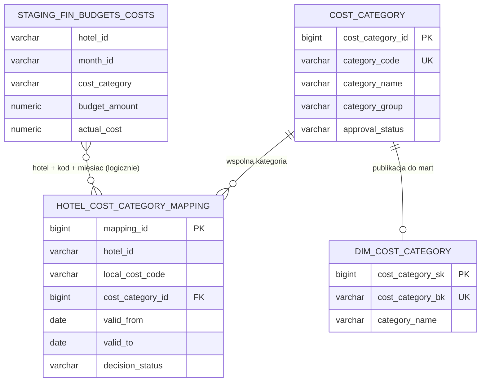

# US-03-07 | Ujednolicenie kategorii kosztów i zasad kwot finansowych

**Projekt:** HotelGroup — hurtownia danych i analityka hotelarska  
**Epika:** EPIC-03 — Hurtownia i modelowanie danych  
**Priorytet:** Must  
**Etap:** Sprint 2  
**Status:** Projekt modelu i mechanizmu kontroli; klasyfikacje i polityka walutowa do zatwierdzenia

## 1. Cel i zakres

Celem jest uzyskanie jednej klasyfikacji kosztów dla wszystkich hoteli sieci. Lokalne kody i nazwy tej samej kategorii muszą wskazywać tę samą kategorię standardową, niezależnie od hotelu. Model powinien umożliwiać wykrycie braku mapowania i konfliktu mapowań bez przypisywania kosztu do przypadkowej kategorii.

Zakres obejmuje: strukturę lokalnych danych kosztowych, wspólny słownik, mapowanie hotel → kategoria standardowa, reguły nazewnictwa, zasady kwot i walut, projekt tabel PostgreSQL oraz zapytania kontrolne. Ujednolicony model rzeczywistych kosztów i budżetów jest odrębnym etapem — tutaj powstaje **słownik i mechanizm klasyfikacji**, a nie pełna tabela faktów finansowych.

## 2. Struktura danych wejściowych

Finansowe dane miesięczne mają następujący kontrakt wejściowy:

| Pole | Typ w PostgreSQL | Interpretacja |
|---|---|---|
| `hotel_id` | `VARCHAR(50)` | Kod hotelu w źródle |
| `month_id` | `VARCHAR(7)` | Miesiąc w zapisie `YYYY-MM` |
| `cost_category` | `VARCHAR(100)` | Lokalna nazwa/kod kategorii kosztowej |
| `budget_amount` | `NUMERIC(12,2)` | Kwota kosztu budżetowanego |
| `actual_cost` | `NUMERIC(12,2)` | Kwota kosztu rzeczywistego |
| `_inserted_at` | `TIMESTAMP` | Czas wczytania danych |

**Istotne ograniczenia:** obecny kontrakt nie zawiera kolumny `currency_code`, trwałego ID rekordu źródłowego ani statusu zatwierdzenia sprawozdania. Dane kosztowe oraz faktycznie używane lokalne kody nie zostały tu ustalone; poniższe przyporządkowania są **propozycją i danymi demonstracyjnymi**, a nie zatwierdzonym słownikiem finansowym. Dane PMS dotyczą m.in. przychodów z pokoi i nie zastępują źródła kosztów operacyjnych.

Do weryfikacji z finansami pozostają: znaczenie pól `actual_cost` i `budget_amount`, moment przypisania kwot do miesiąca, wartości ze znakiem ujemnym (korekty/zwroty), waluta każdego zbioru i klasyfikacja GOP.

## 3. Wspólny słownik kategorii kosztów (projekt do akceptacji)

| Kod standardowy | Grupa | Nazwa standardowa | Interpretacja robocza |
|---|---|---|---|
| `PERSONNEL` | Personel | Koszty osobowe | Wynagrodzenia oraz elementy kosztów osobowych według zatwierdzonego zakresu |
| `UTILITIES` | Eksploatacja | Media i energia | Energia elektryczna, ogrzewanie, woda i inne media |
| `HOUSEKEEPING` | Operacje pokoi | Utrzymanie czystości | Materiały i usługi sprzątania oraz pralni |
| `MAINTENANCE` | Eksploatacja | Naprawy i konserwacja | Serwis, bieżące naprawy i konserwacja |
| `FNB_COGS` | Gastronomia | Koszt produktów F&B | Zakup surowców i produktów zużywanych w gastronomii |
| `SALES_MARKETING` | Sprzedaż | Marketing i promocja | Kampanie i inne uzgodnione koszty promocji |
| `CHANNEL_FEES` | Dystrybucja | Prowizje i opłaty kanałów | Prowizje OTA i inne opłaty dystrybucyjne |
| `ADMIN` | Administracja | Koszty administracyjne | Koszty ogólnoadministracyjne według wspólnej definicji |
| `OTHER_REVIEWED` | Pozostałe | Pozostałe zatwierdzone koszty | Tylko po świadomej klasyfikacji; nie jest domyślną kategorią dla błędów |

To **katalog roboczy**. Przed zatwierdzeniem należy ustalić granice między kategoriami (np. czy pralnia zewnętrzna to `HOUSEKEEPING`, czy usługi obce), sposób traktowania prowizji, kosztów nieoperacyjnych i ich wpływ na GOP. Pole `gop_treatment` przyjmuje `INCLUDED`, `EXCLUDED` albo `TO_REVIEW`; początkowo należy używać `TO_REVIEW`.

### 3.1. Zasady nazywania kategorii

1. Kody standardowe są jednoznaczne w całej sieci i mają format `UPPER_SNAKE_CASE` w języku angielskim.
2. Nazwa wyświetlana biznesowo jest po polsku; definicja słowna rozstrzyga zakres kategorii.
3. Lokalne nazwy nie stanowią kodów globalnych. Mapowanie uwzględnia **hotel, system źródłowy i okres obowiązywania**.
4. Zmiana lokalnej nazwy nie może automatycznie zmieniać przypisania historycznych kosztów.
5. `OTHER_REVIEWED` nie służy do automatycznego ukrywania braków klasyfikacji.
6. Nie klasyfikuje się kosztów wyłącznie po podobieństwie tekstu; każda relacja lokalny → globalny wymaga jawnego przypisania.

## 4. Mapowanie kodów lokalnych na wspólną kategorię

**Przykład wyłącznie demonstracyjny:**

| Hotel | Lokalny kod/kategoria | Kod standardowy | Wynik |
|---|---|---|---|
| H001 | `PENSJE` | `PERSONNEL` | Jedna wspólna kategoria |
| H002 | `WYNAGRODZENIA` | `PERSONNEL` | Jedna wspólna kategoria |
| H001 | `PRĄD` | `UTILITIES` | Jedna wspólna kategoria |
| H002 | `ENERGIA` | `UTILITIES` | Jedna wspólna kategoria |
| H003 | `NIEZNANY_KOD` | — | Brak mapowania — wymaga decyzji |

Przypisanie jest poprawne wyłącznie wtedy, gdy **dokładnie jedno zatwierdzone mapowanie** obowiązuje dla wskazanego hotelu, źródła, lokalnej kategorii i miesiąca. Dla warunku `valid_from <= data < valid_to` koniec okresu jest wyłączny; puste `valid_to` oznacza bezterminowe obowiązywanie.

| Liczba dopasowań | Status | Działanie |
|---:|---|---|
| 1 | `OK` | Dopuścić mapowanie, jeśli kategoria globalna też jest zatwierdzona |
| 0 | `MISSING_MAPPING` | Oznaczyć rekord; przekazać do wyjaśnienia |
| 2 lub więcej | `AMBIGUOUS_MAPPING` | Oznaczyć konflikt; nie wybierać pierwszego dopasowania |
| Dowolna, ale kod globalny niezatwierdzony | `UNAPPROVED_CATEGORY` | Wstrzymać dopuszczenie do modelu raportowego |
| Nieprawidłowy miesiąc lub pusty kod | `BAD_PERIOD` / `EMPTY_CATEGORY` | Przekazać do kontroli danych wejściowych |

Dla korekt klasyfikacji w przyszłości dopisuje się nowy okres mapowania zamiast zmieniać znaczenie kodu historycznego bez uzgodnienia.

## 5. Struktura modelu PostgreSQL

Strefy `staging`, `core` i `mart` mają różne odpowiedzialności:

- **`staging.fin_budgets_costs`** zachowuje wartości źródłowe i lokalne nazwy kategorii.
- **`core.cost_category`** przechowuje wspólny słownik kategorii, definicje i status zatwierdzenia.
- **`core.hotel_cost_category_mapping`** przechowuje relację hotel/źródło/lokalny kod → kategoria globalna wraz z okresem ważności i decyzją.
- **`core.finance_currency_policy`** przechowuje zatwierdzone zasady interpretacji waluty konkretnego strumienia.
- **`mart.dim_cost_category`** stanowi docelowy wymiar kosztu z kluczem zastępczym `cost_category_sk` i kodem biznesowym `cost_category_bk`.

Tabele powstają w skrypcie `20_us_03_07_cost_categories.sql`. Skrypt **nie tworzy automatycznie danych słownikowych, mapowań ani kursów walut**: wpisanie ich wymaga potwierdzenia definicji. Wymiar `mart` będzie zasilany jedynie zatwierdzonymi kategoriami w odrębnym kroku transformacji.

**Uwaga do diagramu:** powiązanie `staging` → mapowanie jest regułą transformacji, a nie fizycznym FK w warstwie surowej. Publikacja kategorii do `mart` również jest procesem transformacji, a nie bezpośrednią relacją FK między schematami.

## 6. Polityka kwot i walut — do zatwierdzenia

1. **Waluta raportowa:** proponowana `PLN`. Jest to wybór projektowy wymagający akceptacji, nie informacja ustalona w źródle.
2. **Oryginalne kwoty:** zachować bez zmiany znaczenia biznesowego. Używać `NUMERIC` zamiast typów przybliżonych `FLOAT`/`REAL` w warstwie finansowej.
3. **Dokładność:** prezentacja kwot w PLN do dwóch miejsc po przecinku, a kursów — z większą dokładnością ustaloną w polityce finansowej; nie stosować kolejnych zaokrągleń podczas agregacji.
4. **Znaki:** kwoty ujemne mogą oznaczać korekty/storna. Nie wolno odwracać znaków ani usuwać takich wartości bez ustalenia zasad księgowych.
5. **Źródło waluty:** obecna tabela wejściowa nie zawiera `currency_code`. Przed przeliczeniem kwot musi istnieć zatwierdzona deklaracja waluty dla danego strumienia/hotelu albo rozszerzone źródło zawierające walutę na poziomie rekordu.
6. **Przeliczenie:** dla `source_currency = reporting_currency` współczynnik wynosi 1; dla innych walut wymagane są zatwierdzone źródło kursu, data kursu, metoda i zasady zaokrągleń. Bez tego nie oblicza się kwoty raportowej.
7. **Budżet a wykonanie:** oba scenariusze porównywać dla tego samego hotelu, miesiąca, kategorii i waluty. Nie mieszać kwot budżetowych z rzeczywistymi.
8. **Kontrola zgodności:** wykazać odchylenie przychodów względem źródeł zgodne z NFR-02 w osobnym procesie uzgodnienia; samo mapowanie kosztów nie potwierdza tego wymagania.
9. **Zmiany polityki:** zasady walut i mapowań obowiązują w jawnych przedziałach dat; dla danego hotelu/źródła/okresu dopuszcza się jedną zatwierdzoną interpretację.

Dopóki nie ma potwierdzenia waluty, przeliczanie danych finansowych do `mart` ma status **zablokowane / do uzgodnienia**.

## 7. Kontrole i scenariusze testowe

| Test | Given | When | Then | Status dowodu |
|---|---|---|---|---|
| T-01: synonimy między hotelami | H001=`PENSJE`, H002=`WYNAGRODZENIA` | Mapowanie dla wspólnego miesiąca | Obie wartości otrzymują `PERSONNEL` | Scenariusz demonstracyjny w SQL |
| T-02: brak przypisania | Lokalny kod nie występuje w mapowaniu | Uruchomiona kontrola | `MISSING_MAPPING`, brak przypadkowej kategorii | Scenariusz demonstracyjny w SQL |
| T-03: niejednoznaczne przypisanie | Dwa zatwierdzone mapowania nakładają się czasowo | Uruchomiona kontrola | `AMBIGUOUS_MAPPING`, brak automatycznego wyboru | Scenariusz demonstracyjny w SQL |
| T-04: niezatwierdzona kategoria | Mapowanie wskazuje kategorię `DRAFT` | Uruchomiona kontrola | `UNAPPROVED_CATEGORY` | Zapytanie walidacyjne |
| T-05: różne waluty | Koszt w walucie innej niż sprawozdawcza | Próba przygotowania raportu | Wymagany zatwierdzony kurs i reguła przeliczenia | Do testu na danych finansowych |
| T-06: porównywalność finansowa | Dostępne fakty dla dwóch hoteli i tej samej kategorii | Raport kosztowy | Zgodne definicje i kwoty w tej samej walucie | Do testu po zasileniu danych |

Plik `22_us_03_07_demo_test.sql` uruchamia **testy na danych sztucznych** w transakcji i kończy je `ROLLBACK`, dzięki czemu nie zostawia testowych rekordów w słowniku. Plik `21_us_03_07_validation_queries.sql` zawiera kontrole dla tabeli finansowej i polityk walutowych. **Nie oznacza to, że testy zostały wykonane na działającej bazie**; wymaga to uruchomienia plików w PostgreSQL i zachowania wyników.

## 8. Powiązanie z wymaganiami

| ID | Związek z realizacją |
|---|---|
| **R-31** | Wspólna klasyfikacja i mapowanie lokalnych kategorii kosztowych |
| **NFR-11** | Jednakowe nazwy i definicje kategorii w całej sieci |
| **R-02** | Wykrywanie braków/konfliktów mapowań; obsługa odrzuceń przez proces integracji |
| **NFR-13** | Jawne jednostki, waluta i format prezentacji kwot |
| **R-41** | Dostarczenie wspólnych kategorii do analizy budżetu i kosztów rzeczywistych |

## 9. Kryteria akceptacji US-03-07

**AC-1. Ujednolicenie**  
**Given:** dwa hotele używają odmiennych nazw tej samej kategorii; **When:** rekordy przechodzą przez zatwierdzone mapowania; **Then:** otrzymują identyczny kod kategorii standardowej.

**AC-2. Brak mapowania**  
**Given:** lokalna kategoria nie ma przyporządkowania; **When:** uruchamiana jest walidacja; **Then:** zostaje zgłoszony brak mapowania, bez cichego przypisania do niewłaściwej kategorii.

**AC-3. Spójność walutowa**  
**Given:** porównywane są koszty wielu hoteli; **When:** model przekazuje kwoty do raportowania; **Then:** waluta odniesienia i znaczenie kategorii są jawne, spójne i oparte na zatwierdzonych zasadach.

## 10. Stan realizacji listy zadań

| Podpunkt checklisty | Stan |
|---|---|
| Przeanalizować strukturę danych kosztowych i lokalne kategorie | Struktura pól opisana; **rzeczywiste lokalne kody do weryfikacji** |
| Zidentyfikować różnice między hotelami | Mechanizm i przykłady opracowane; **rzeczywiste różnice do weryfikacji** |
| Uzgodnić z kontrolerem wspólny słownik | **Do zatwierdzenia** |
| Zaprojektować standardowe kategorie w core/mart | **Projekt przygotowany** |
| Opracować mapowanie kodów hotel → standard | **Struktura i przykład przygotowane** |
| Zdefiniować jednolite reguły nazewnictwa | **Projekt przygotowany** |
| Uzgodnić walutę sprawozdawczą i przeliczanie | **Propozycja PLN, do zatwierdzenia** |
| Przygotować SQL słownika i mapowania | **Skrypt DDL przygotowany; wykonanie do potwierdzenia** |
| Zdefiniować wykrywanie błędnych mapowań | **Zapytania i scenariusze przygotowane** |
| Przetestować mapowania na danych różnych hoteli | **Scenariusz demonstracyjny przygotowany; wykonanie i test na danych finansowych do zrobienia** |
| Udokumentować zasady i dodać do Git | **Dokument przygotowany; commit i przegląd do wykonania** |

## 11. Dalsza weryfikacja

Przed formalnym zamknięciem zadania należy: (1) pozyskać reprezentatywne dane kosztowe przynajmniej dwóch hoteli, (2) zatwierdzić klasyfikację i politykę walut z osobą odpowiedzialną za finanse oraz Product Ownerem, (3) wykonać DDL i testy w PostgreSQL, (4) wyjaśnić brakujące/konfliktowe mapowania, (5) zapisać wyniki i potwierdzenia w dokumentacji projektu.

**Zasada:** elementy projektowe można przeglądać i wersjonować już teraz, ale nie należy oznaczać niesprawdzonych mapowań, walut ani testów jako faktycznie zaakceptowanych.
