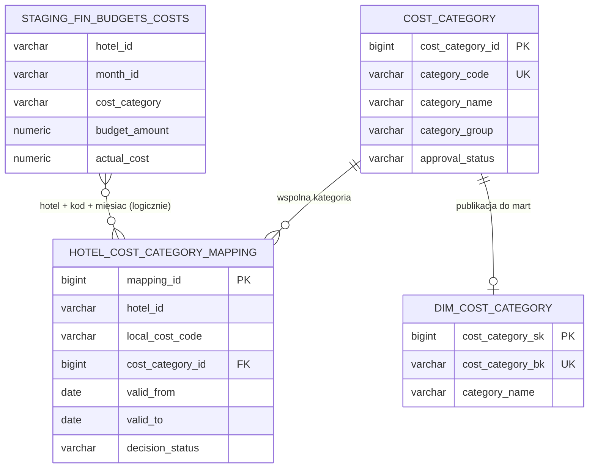

# US-03-07 | Ujednolicenie kategorii kosztów i zasad kwot finansowych

**Projekt:** HotelGroup — hurtownia danych i analityka hotelarska  
**Epika:** EPIC-03 — Hurtownia i modelowanie danych  
**Priorytet:** Must  
**Etap:** Sprint 2  
**Status:** Zasady projektu przyjęte; katalog kodów i przyporządkowania lokalne przygotowane do weryfikacji na źródłach finansowych. Testy na danych syntetycznych zakończone powodzeniem.

## 1. Cel i zakres

Celem jest uzyskanie jednej klasyfikacji kosztów dla wszystkich hoteli sieci. Lokalne kody i nazwy tej samej kategorii muszą wskazywać tę samą kategorię standardową, niezależnie od hotelu. Model powinien umożliwiać wykrycie braku mapowania i konfliktu mapowań bez przypisywania kosztu do przypadkowej kategorii.

### 1.1. Przyjęte zasady finansowe HotelGroup

W ramach projektu przyjęto następujące zasady:

1. **Walutą sprawozdawczą jest PLN.**
2. **Wszystkie hotele korzystają ze wspólnego słownika kategorii kosztowych.**
3. **Różne lokalne nazwy tej samej kategorii są przypisywane do jednego kodu standardowego** na podstawie jawnego mapowania.
4. **Koszty budżetowane i rzeczywiste przechowuje się oddzielnie** i porównuje w tym samym hotelu, miesiącu, kategorii i walucie.
5. **Brak mapowania lub konflikt wymaga wyjaśnienia**; nie wolno ich automatycznie naprawiać ani ukrywać przez kategorię „Inne”.

Są to uzgodnione **założenia zespołowe projektu**. Nie stanowią potwierdzenia, że określone osoby spoza zespołu zaakceptowały szczegółowe kody księgowe lub że źródłowe pliki finansowe faktycznie zawierają walutę PLN.

Zakres obejmuje: strukturę lokalnych danych kosztowych, wspólny słownik, mapowanie hotel → kategoria standardowa, reguły nazewnictwa, zasady kwot i walut, projekt tabel PostgreSQL oraz zapytania kontrolne. Ujednolicony model rzeczywistych kosztów i budżetów jest odrębnym etapem — tutaj powstaje **słownik i mechanizm klasyfikacji**, a nie pełna tabela faktów finansowych.

## 2. Struktura danych wejściowych

Finansowe dane miesięczne mają następujący kontrakt wejściowy:

| Pole | Typ w PostgreSQL | Interpretacja |
|---|---|---|
| `hotel_id` | `VARCHAR(50)` | Kod hotelu w źródle |
| `month_id` | `VARCHAR(7)` | Miesiąc w zapisie `YYYY-MM` |
| `cost_category` | `VARCHAR(100)` | Lokalna nazwa/kod kategorii kosztowej |
| `budget_amount` | `NUMERIC(12,2)` | Kwota kosztu budżetowanego |
| `actual_cost` | `NUMERIC(12,2)` | Kwota kosztu rzeczywistego |
| `_inserted_at` | `TIMESTAMP` | Czas wczytania danych |

**Istotne ograniczenia:** obecny kontrakt nie zawiera kolumny `currency_code`, trwałego ID rekordu źródłowego ani statusu zatwierdzenia sprawozdania. Dane kosztowe oraz faktycznie używane lokalne kody nie zostały tu ustalone; poniższe przyporządkowania są **propozycją i danymi demonstracyjnymi**, a nie zatwierdzonym słownikiem finansowym. Dane PMS dotyczą m.in. przychodów z pokoi i nie zastępują źródła kosztów operacyjnych.

Do weryfikacji z finansami pozostają: znaczenie pól `actual_cost` i `budget_amount`, moment przypisania kwot do miesiąca, wartości ze znakiem ujemnym (korekty/zwroty), waluta każdego zbioru i klasyfikacja GOP.

## 3. Wspólny słownik kategorii kosztów

| Kod standardowy | Grupa | Nazwa standardowa | Interpretacja robocza |
|---|---|---|---|
| `PERSONNEL` | Personel | Koszty osobowe | Wynagrodzenia oraz elementy kosztów osobowych według zatwierdzonego zakresu |
| `UTILITIES` | Eksploatacja | Media i energia | Energia elektryczna, ogrzewanie, woda i inne media |
| `HOUSEKEEPING` | Operacje pokoi | Utrzymanie czystości | Materiały i usługi sprzątania oraz pralni |
| `MAINTENANCE` | Eksploatacja | Naprawy i konserwacja | Serwis, bieżące naprawy i konserwacja |
| `FNB_COGS` | Gastronomia | Koszt produktów F&B | Zakup surowców i produktów zużywanych w gastronomii |
| `SALES_MARKETING` | Sprzedaż | Marketing i promocja | Kampanie i inne uzgodnione koszty promocji |
| `CHANNEL_FEES` | Dystrybucja | Prowizje i opłaty kanałów | Prowizje OTA i inne opłaty dystrybucyjne |
| `ADMIN` | Administracja | Koszty administracyjne | Koszty ogólnoadministracyjne według wspólnej definicji |
| `OTHER_REVIEWED` | Pozostałe | Pozostałe zatwierdzone koszty | Tylko po świadomej klasyfikacji; nie jest domyślną kategorią dla błędów |

To **katalog roboczych kodów i definicji**, przygotowany w ramach przyjętej zasady wspólnego słownika. Przed wykorzystaniem konkretnych kodów w danych finansowych należy zweryfikować granice między kategoriami (np. czy pralnia zewnętrzna to `HOUSEKEEPING`, czy usługi obce), sposób traktowania prowizji, kosztów nieoperacyjnych i ich wpływ na GOP. Pole `gop_treatment` przyjmuje `INCLUDED`, `EXCLUDED` albo `TO_REVIEW`; początkowo należy używać `TO_REVIEW`.

### 3.1. Zasady nazywania kategorii

1. Kody standardowe są jednoznaczne w całej sieci i mają format `UPPER_SNAKE_CASE` w języku angielskim.
2. Nazwa wyświetlana biznesowo jest po polsku; definicja słowna rozstrzyga zakres kategorii.
3. Lokalne nazwy nie stanowią kodów globalnych. Mapowanie uwzględnia **hotel, system źródłowy i okres obowiązywania**.
4. Zmiana lokalnej nazwy nie może automatycznie zmieniać przypisania historycznych kosztów.
5. `OTHER_REVIEWED` nie służy do automatycznego ukrywania braków klasyfikacji.
6. Nie klasyfikuje się kosztów wyłącznie po podobieństwie tekstu; każda relacja lokalny → globalny wymaga jawnego przypisania.

## 4. Mapowanie kodów lokalnych na wspólną kategorię

**Przykłady lokalnych kodów – do weryfikacji po udostępnieniu danych finansowych:**

| Hotel | Lokalny kod/kategoria | Kod standardowy | Wynik |
|---|---|---|---|
| H001 | `PENSJE` | `PERSONNEL` | Jedna wspólna kategoria |
| H002 | `WYNAGRODZENIA` | `PERSONNEL` | Jedna wspólna kategoria |
| H001 | `PRĄD` | `UTILITIES` | Jedna wspólna kategoria |
| H002 | `ENERGIA` | `UTILITIES` | Jedna wspólna kategoria |
| H003 | `NIEZNANY_KOD` | — | Brak mapowania — wymaga decyzji |

Przypisanie jest poprawne wyłącznie wtedy, gdy **dokładnie jedno zatwierdzone mapowanie** obowiązuje dla wskazanego hotelu, źródła, lokalnej kategorii i miesiąca. Dla warunku `valid_from <= data < valid_to` koniec okresu jest wyłączny; puste `valid_to` oznacza bezterminowe obowiązywanie.

| Liczba dopasowań | Status | Działanie |
|---:|---|---|
| 1 | `OK` | Dopuścić mapowanie, jeśli kategoria globalna też jest zatwierdzona |
| 0 | `MISSING_MAPPING` | Oznaczyć rekord; przekazać do wyjaśnienia |
| 2 lub więcej | `AMBIGUOUS_MAPPING` | Oznaczyć konflikt; nie wybierać pierwszego dopasowania |
| Dowolna, ale kod globalny niezatwierdzony | `UNAPPROVED_CATEGORY` | Wstrzymać dopuszczenie do modelu raportowego |
| Nieprawidłowy miesiąc lub pusty kod | `BAD_PERIOD` / `EMPTY_CATEGORY` | Przekazać do kontroli danych wejściowych |

Dla korekt klasyfikacji w przyszłości dopisuje się nowy okres mapowania zamiast zmieniać znaczenie kodu historycznego bez uzgodnienia.

## 5. Struktura modelu PostgreSQL

Strefy `staging`, `core` i `mart` mają różne odpowiedzialności:

- **`staging.fin_budgets_costs`** zachowuje wartości źródłowe i lokalne nazwy kategorii.
- **`core.cost_category`** przechowuje wspólny słownik kategorii, definicje i status zatwierdzenia.
- **`core.hotel_cost_category_mapping`** przechowuje relację hotel/źródło/lokalny kod → kategoria globalna wraz z okresem ważności i decyzją.
- **`core.finance_currency_policy`** przechowuje zatwierdzone zasady interpretacji waluty konkretnego strumienia.
- **`mart.dim_cost_category`** stanowi docelowy wymiar kosztu z kluczem zastępczym `cost_category_sk` i kodem biznesowym `cost_category_bk`.

Struktury powstają w skrypcie `20_us_03_07_cost_categories.sql`. Uzupełniający skrypt `23_us_03_07_seed_dictionary.sql` zapisuje na stałe dziewięć kategorii roboczych w statusie `DRAFT`, kilka przykładowych mapowań `DRAFT` oraz globalne, uzgodnione zasady raportowania w PLN w `core.finance_reporting_settings`. **Nie nadaje on przykładowym mapowaniom statusu `APPROVED`**, ponieważ nazwy w rzeczywistych danych finansowych nie zostały jeszcze potwierdzone. Nie zapisuje też kursów walut ani nie zakłada, że źródłowe kwoty wszystkich hoteli są w PLN. Skrypt `24_us_03_07_verify_seed.sql` sprawdza wykonane zapisy i jest tylko do odczytu. Wymiar `mart` będzie zasilany jedynie zweryfikowanymi kategoriami w osobnym kroku transformacji.

**Uwaga do diagramu:** powiązanie `staging` → mapowanie jest regułą transformacji, a nie fizycznym FK w warstwie surowej. Publikacja kategorii do `mart` również jest procesem transformacji, a nie bezpośrednią relacją FK między schematami.

## 6. Przyjęta polityka kwot i walut

1. **Waluta sprawozdawcza:** `PLN` (przyjęta zasada dla całej sieci).
2. **Oryginalne kwoty:** przechowuje się bez zmiany ich znaczenia w warstwie wejściowej; docelowe kwoty finansowe zapisuje się w precyzyjnym typie `NUMERIC`, a nie `FLOAT`/`REAL`.
3. **Dokładność:** kwoty w PLN prezentuje się do dwóch miejsc po przecinku. Nie wykonuje się przedwczesnych zaokrągleń przed agregacją.
4. **Koszty budżetowane i rzeczywiste:** pozostają oddzielnymi wartościami (`budget_amount`, `actual_cost`); porównywanie wymaga wspólnego hotelu, miesiąca, kategorii i waluty.
5. **Znaki kwot:** wartości ujemne mogą oznaczać korekty lub storna. Nie zmienia się ich automatycznie.
6. **Waluta źródłowa:** obecny kontrakt danych finansowych nie zawiera pola `currency_code`. Przyjęcie PLN jako waluty **raportowej** nie dowodzi, że wszystkie kwoty źródłowe są wyrażone w PLN.
7. **Przeliczenia:** jeśli potwierdzono `source_currency = PLN`, przelicznik do PLN wynosi 1. Dla innych walut konieczne jest wskazanie waluty rekordu lub jednorodnego strumienia, źródła kursu, daty kursu i reguł zaokrąglania. **Bez tych informacji nie dokonuje się przeliczenia ani publikacji kwot jako PLN.**
8. **Kontrola mapowania:** dokładnie jedno zatwierdzone mapowanie przypisuje lokalną kategorię do kodu standardowego w danym okresie. Brak i konflikt kierowane są do wyjaśnienia, nie do automatycznej korekty.
9. **Zmiany w czasie:** mapowania i interpretacje walut obowiązują w jawnych przedziałach `[valid_from, valid_to)`.
10. **Uzgodnienie danych:** test zgodności sum przychodów z NFR-02 należy przeprowadzić osobno; samo ujednolicenie kosztów go nie zastępuje.

Zasady ogólne (PLN, jawne mapowania, oddzielenie budżetu od wykonania i obsługa niezgodności) są **przyjęte**. Szczegółowe przypisanie waluty źródłowej do strumieni hoteli oraz ewentualne kursy pozostają do ustalenia po udostępnieniu danych finansowych.

## 7. Kontrole i scenariusze testowe

| Test | Given | When | Then | Status dowodu |
|---|---|---|---|---|
| T-01: synonimy między hotelami | H001=`PENSJE`, H002=`WYNAGRODZENIA` | Mapowanie dla wspólnego miesiąca | Obie wartości otrzymują `PERSONNEL` | Test demonstracyjny wykonany lokalnie w PostgreSQL |
| T-02: brak przypisania | Lokalny kod nie występuje w mapowaniu | Uruchomiona kontrola | `MISSING_MAPPING`, brak przypadkowej kategorii | Test demonstracyjny wykonany lokalnie w PostgreSQL |
| T-03: niejednoznaczne przypisanie | Dwa zatwierdzone mapowania nakładają się czasowo | Uruchomiona kontrola | `AMBIGUOUS_MAPPING`, brak automatycznego wyboru | Test demonstracyjny wykonany lokalnie w PostgreSQL |
| T-04: niezatwierdzona kategoria | Mapowanie wskazuje kategorię `DRAFT` | Uruchomiona kontrola | `UNAPPROVED_CATEGORY` | Zapytanie walidacyjne przygotowane i wykonane bez błędów SQL |
| T-05: różne waluty | Koszt w walucie innej niż sprawozdawcza | Próba przygotowania raportu | Wymagany zatwierdzony kurs i reguła przeliczenia | Do testu na danych finansowych |
| T-06: porównywalność finansowa | Dostępne fakty dla dwóch hoteli i tej samej kategorii | Raport kosztowy | Zgodne definicje i kwoty w tej samej walucie | Do testu po zasileniu danych |

### 7.1. Wyniki testów przeprowadzonych lokalnie

Test demonstracyjny z danymi finansowymi **trzech syntetycznych hoteli** zakończył się powodzeniem:

- 4 poprawne przyporządkowania lokalnych kodów do wspólnych kategorii;
- 1 prawidłowo wykryty brak mapowania;
- 1 prawidłowo wykryty konflikt mapowań;
- 5 poprawnych dopasowań do demonstracyjnej polityki PLN i 1 brak polityki;
- suma kosztów `PERSONNEL`: **22 200,00 PLN**;
- suma kosztów `UTILITIES`: **5 550,00 PLN**.

Transakcja testowa zakończyła się `ROLLBACK`, więc **dane demonstracyjne nie zostały zachowane**. Sprawdzono również utworzenie tabel oraz uruchomiono zapytania walidacyjne bez błędów SQL. Wyniki te potwierdzają działanie mechanizmu na danych testowych, nie są kontrolą rzeczywistych kosztów ani przeliczania walut obcych.

Plik `22_us_03_07_demo_test.sql` uruchamia **testy na danych sztucznych** w transakcji i kończy je `ROLLBACK`, dzięki czemu nie zostawia testowych rekordów w słowniku. Plik `21_us_03_07_validation_queries.sql` zawiera kontrole dla tabeli finansowej i polityk walutowych. Testy opisane powyżej zostały wykonane w lokalnym PostgreSQL. Dodatkowy skrypt zapisujący dane referencyjne `23_us_03_07_seed_dictionary.sql` wymaga osobnego uruchomienia i kontroli; nie należy traktować go jako już wykonanego.

## 8. Powiązanie z wymaganiami

| ID | Związek z realizacją |
|---|---|
| **R-31** | Wspólna klasyfikacja i mapowanie lokalnych kategorii kosztowych |
| **NFR-11** | Jednakowe nazwy i definicje kategorii w całej sieci |
| **R-02** | Wykrywanie braków/konfliktów mapowań; obsługa odrzuceń przez proces integracji |
| **NFR-13** | Jawne jednostki, waluta i format prezentacji kwot |
| **R-41** | Dostarczenie wspólnych kategorii do analizy budżetu i kosztów rzeczywistych |

## 9. Kryteria akceptacji US-03-07

**AC-1. Ujednolicenie**  
**Given:** dwa hotele używają odmiennych nazw tej samej kategorii; **When:** rekordy przechodzą przez zatwierdzone mapowania; **Then:** otrzymują identyczny kod kategorii standardowej.

**AC-2. Brak mapowania**  
**Given:** lokalna kategoria nie ma przyporządkowania; **When:** uruchamiana jest walidacja; **Then:** zostaje zgłoszony brak mapowania, bez cichego przypisania do niewłaściwej kategorii.

**AC-3. Spójność walutowa**  
**Given:** porównywane są koszty wielu hoteli; **When:** model przekazuje kwoty do raportowania; **Then:** waluta odniesienia i znaczenie kategorii są jawne, spójne i oparte na zatwierdzonych zasadach.

## 10. Stan realizacji listy zadań

| Podpunkt checklisty | Stan |
|---|---|
| Przeanalizować strukturę danych kosztowych i lokalne kategorie | Struktura tabeli wejściowej przeanalizowana; docelowe kody lokalne wymagają weryfikacji na danych finansowych. |
| Zidentyfikować różnice między hotelami | Opracowano przypadki testowe różnych lokalnych nazw; rzeczywiste różnice pozostają do sprawdzenia. |
| Uzgodnić wspólny słownik kategorii | Przyjęto obowiązek jednego słownika dla całej sieci; szczegółowy katalog kodów i granice kategorii wymagają weryfikacji. |
| Zaprojektować standardowe kategorie w core/mart | Wykonano: tabele utworzone w PostgreSQL. |
| Opracować mapowanie kodów hotel → standard | Mechanizm przygotowany i przetestowany; robocze przypisania wymagają potwierdzenia na źródłach. |
| Zdefiniować reguły nazewnictwa | Wykonano: jednolite kody `UPPER_SNAKE_CASE`, definicje i jawne okresy obowiązywania. |
| Uzgodnić walutę sprawozdawczą i przeliczanie | Przyjęto PLN. Reguły dla kwot źródłowych w innych walutach wymagają kursu i daty; bez nich nie przelicza się kwot. |
| Przygotować struktury SQL | Wykonano: DDL i test demonstracyjny uruchomiono lokalnie. |
| Zdefiniować wykrywanie błędnych mapowań | Wykonano i pozytywnie przetestowano na danych syntetycznych. |
| Przetestować mapowanie danych różnych hoteli | Test trzech hoteli syntetycznych zaliczony; weryfikacja danych docelowych pozostaje otwarta. |
| Udokumentować zasady i zapisać zmiany w Git | Dokumentacja i wcześniejsze skrypty dodane do Pull Requesta. Uzupełnienie o wersję polityki i trwały seed wymaga kolejnego commitu na tej samej gałęzi. |

## 11. Zasady dalszego wykorzystania

- Uruchomić `23_us_03_07_seed_dictionary.sql` wyłącznie w bazie `hotelgroup_dw`, następnie `24_us_03_07_verify_seed.sql`.
- Katalog kosztów i lokalne przyporządkowania demonstracyjne zapisane w statusie `DRAFT` **nie są aktywnymi zatwierdzonymi mapowaniami**. Nie uruchamiać na ich podstawie automatycznego zasilenia `mart`.
- PLN jest przyjętą walutą raportową. Tabeli `core.finance_currency_policy` nie wolno wypełnić zatwierdzonymi założeniami o walutach źródłowych bez potwierdzenia tych walut.
- Gdy dostępne będą pliki finansowe hoteli, porównać ich lokalne kody z katalogiem, rozstrzygnąć niejednoznaczności i dopiero wtedy zatwierdzić odpowiednie mapowania oraz uzupełnić szczegółowe polityki walutowe.
- Wyniki weryfikacji zachowywać w dokumentacji testów; poprzednich zatwierdzonych wpisów nie nadpisywać bez osobnej decyzji.
